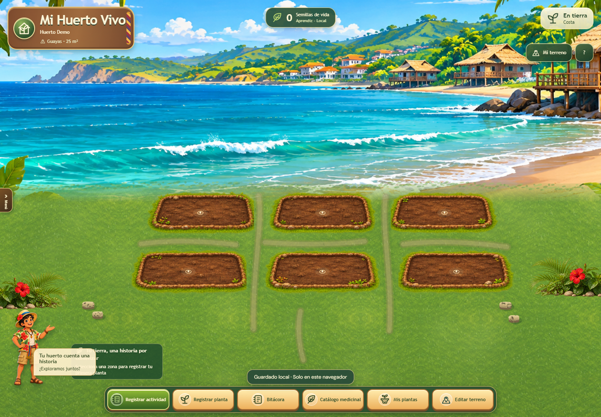
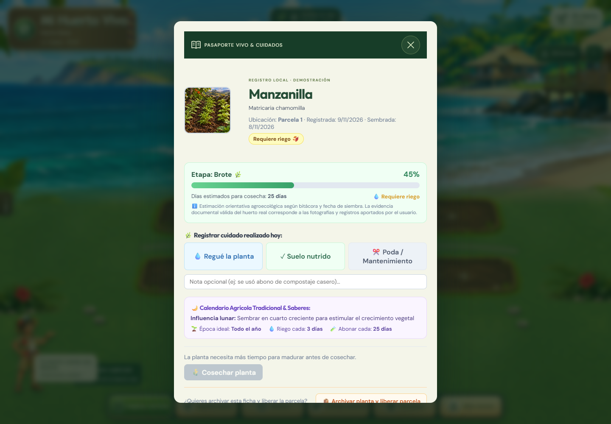

# 🌱 Kawsapacha — Mi Huerto Vivo

### Cultivamos en la tierra. Hacemos visible cada historia.

**Kawsapacha** es una aplicación web educativa e interactiva para acompañar la creación y el cuidado de **huertos medicinales comunitarios en Ecuador**. Conecta lo que sucede en un huerto real con un jardín virtual, permitiendo registrar plantas, fotografías, actividades y su evolución.

Desarrollado por **OptiCode**, como proyecto académico de **Calidad de Software de la Escuela Politécnica Nacional (EPN)**.

> **Nuestra idea:** que cuidar y documentar un huerto medicinal sea una experiencia sencilla, visual, participativa y motivadora.

---

## 🌿 ¿Qué problema buscamos resolver?

En una comunidad, el trabajo de sembrar, regar, cuidar y cosechar puede quedar repartido entre cuadernos, fotografías y recuerdos. Así resulta difícil consultar qué se hizo, cómo evoluciona cada planta y qué personas participan.

**Kawsapacha reúne ese seguimiento en un mismo lugar** y lo presenta de una manera accesible, combinando el registro de información con una experiencia inspirada en los videojuegos.

## ✨ ¿Qué puedes hacer con Kawsapacha?

| Funcionalidad | ¿Para qué sirve? |
| --- | --- |
| 👥 **Comunidades** | Crear y administrar comunidades de cultivo y sus integrantes. |
| 🏡 **Mi Huerto** | Registrar un huerto real, su ubicación y características de cultivo. |
| 🎮 **Mi Jardín Vivo** | Visualizar el huerto en un escenario interactivo con seis parcelas. |
| 📸 **Registro de plantas** | Asociar cada cultivo a una especie, una parcela y fotografías reales. |
| 🌱 **Pasaporte Vivo** | Consultar la información, las evidencias y la etapa observada de cada planta. |
| 📖 **Bitácora Viva** | Documentar actividades y consultar el historial de cuidados del cultivo. |
| 🌙 **Calendario y catálogo medicinal** | Consultar especies e información educativa sobre el cultivo y el calendario lunar. |
| 🏅 **Mi Camino Verde** | Incentivar la participación mediante puntos, misiones y recompensas. |
| 🛡️ **Gestión institucional** | Ofrecer funciones de revisión y administración según los permisos del sistema. |

## 🕹️ ¿Por qué tiene una apariencia de videojuego?

Porque **Kawsapacha no quiere que el cuidado de un huerto se convierta únicamente en llenar formularios**.

Su jardín virtual muestra paisajes inspirados en las cuatro regiones naturales del Ecuador: **Costa, Sierra, Amazonía y Galápagos**. Además, contempla distintas formas de cultivar: **en tierra, macetas, vertical y colgante**.

Las parcelas, los paisajes y las recompensas ayudan a que el proceso resulte más comprensible y atractivo. **Las actividades siguen correspondiendo a un cultivo real**: el entorno gráfico es una forma de representarlas, no un juego de agricultura ficticia.

## 📷 Conoce el proyecto

| Mi Jardín Vivo | Pasaporte Vivo |
| :---: | :---: |
|  |  |
| Escenario de cultivo interactivo | Información y seguimiento de una planta registrada |

*Capturas de una versión de trabajo del proyecto. La apariencia puede cambiar conforme evoluciona el producto.*

## 🔄 ¿Cómo funciona?

1. **Crea una cuenta** y, si corresponde, registra tu comunidad.
2. **Registra tu huerto real:** ubicación, modalidad y características del terreno.
3. **Entra a Mi Jardín Vivo** y selecciona uno de sus espacios de cultivo.
4. **Registra una planta** con su especie, fotografía y observaciones.
5. **Documenta sus cuidados** y consulta su evolución desde el Pasaporte Vivo, la Bitácora y las actividades del jardín.

### Un espejo digital del huerto real

El **Espejo Digital Evolutivo** vincula los registros de una planta real con su representación visual. Cuando una persona añade nuevas fotografías y observaciones, el sistema puede reflejar la etapa documentada del cultivo y conservar su historial.

**Importante:** Kawsapacha no identifica automáticamente las especies ni diagnostica el estado de una planta mediante inteligencia artificial. La especie y las observaciones son registradas por la persona usuaria.

## 💚 ¿A quién está dirigido?

A comunidades barriales, familias, grupos de cultivo, iniciativas educativas y personas interesadas en registrar y acompañar el cuidado de huertos medicinales.

También contempla perfiles institucionales para revisar información y actividades, de acuerdo con los permisos establecidos en el software.

## 🚀 Estado del proyecto

Kawsapacha cuenta con una base funcional de gestión de cuentas, comunidades, huertos, plantas, fotografías, jardín interactivo, actividades y seguimiento del cultivo. **Es un proyecto académico en evolución**, por lo que algunas funciones y validaciones siguen en desarrollo.

Entre las ampliaciones previstas están el **foro comunitario**, los **eventos**, el **ranking entre comunidades** y otras herramientas de participación. No se presentan aquí como funcionalidades terminadas.

**Acceso:** este repositorio contiene el código y la documentación. La disponibilidad de una instancia pública debe confirmarse con el equipo; no se incluye una URL de producción sin verificarla.

## 🛠️ ¿Cómo está construido?

El proyecto combina una interfaz web con un jardín 2D interactivo y un backend que guarda los datos registrados.

| Área | Tecnologías principales |
| --- | --- |
| Interfaz web | React, TypeScript y Vite |
| Jardín interactivo | Phaser 3 |
| Servidor y API | Node.js, Express y TypeScript |
| Persistencia | Prisma ORM y SQLite |
| Pruebas | Playwright y GitHub Actions |
| Preparación de despliegue | Docker y Caddy |

La organización del código sigue un **monolito modular con principios de Clean Architecture**, para separar responsabilidades y facilitar el mantenimiento.

### Para desarrolladores

- [Iniciar el frontend](frontend/README.md)
- [Configurar y ejecutar el backend](backend/README.md)
- [Arquitectura y módulos](docs/architecture/README.md)
- [Instrucciones de despliegue Docker/HTTPS](docs/arquitectura/despliegue-docker-https.md)

## 📚 Documentación del proyecto

La documentación de análisis, diseño y calidad está disponible para quienes quieran conocer cómo se desarrolló Kawsapacha:

- [Historias de usuario y requisitos](docs/historias-usuario/historias-usuario-v1.md)
- [Alcance de la primera versión](docs/analisis/alcance-v1.md)
- [Diseño y evidencias visuales](docs/diseno/entrega-ui-ux-v1.md)
- [Casos de prueba y resultados](docs/casos-prueba/README.md)
- [Informe del proyecto](docs/informe/informe-v1.md)
- [Organización general de la documentación](docs/README.md)

## 👨‍💻 Equipo OptiCode

Proyecto desarrollado en la **Escuela Politécnica Nacional**:

- **Leonel Morales:** dirección del proyecto y desarrollo frontend.
- **Ronny Veloz:** backend, base de datos y arquitectura.
- **Dylan Maldonado:** diseño y experiencia de usuario.
- **Leonardo Lugmaña:** análisis de requisitos y documentación.
- **Santiago Guamán:** aseguramiento de calidad y despliegue.

## ℹ️ Nota de uso

Kawsapacha es un **proyecto académico**, no una plataforma oficial del Ministerio de Salud Pública del Ecuador. Toma como referencia información educativa y lineamientos relacionados con huertos medicinales; **no reemplaza el asesoramiento profesional de salud** ni debe interpretarse como prescripción médica.

---

**🌱 Kawsapacha — Mi Huerto Vivo**  
*Cada planta tiene una historia. Hagamos que su crecimiento se pueda compartir.*
