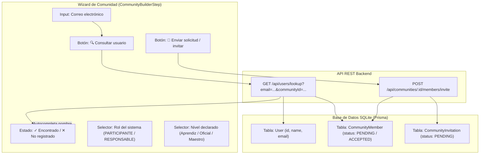

# 📋 PROMPT DE IMPLEMENTACIÓN: CONSULTA DE CORREOS Y ENVÍO DE SOLICITUDES DE INTEGRANTES EN EL WIZARD DE COMUNIDADES

## 🎯 OBJETIVO
Implementar en el formulario de registro y edición de integrantes de la comunidad (`CommunityBuilderStep.tsx` / `CommunityForm.tsx`) dos funcionalidades interactivas clave conectadas a la base de datos SQLite y al backend REST:
1. **Botón de Consulta de Correo ("Consultar usuario"):** Permite verificar en tiempo real si el correo electrónico ingresado pertenece a un usuario registrado en Kawsapacha, mostrando su nombre y estado (miembro actual, invitación pendiente o usuario disponible).
2. **Botón de Envío de Solicitud ("Mandar solicitud / invitar"):** Permite enviar inmediatamente la invitación de membresía si la comunidad ya existe en edición, o dejar la solicitud validada y lista para ser despachada automáticamente al momento de confirmar y guardar la nueva comunidad.
3. **Claridad de Roles vs. Saberes:** Mantener estrictamente el sistema de 2 roles de base de datos (`RESPONSABLE` y `PARTICIPANTE`), diferenciándolo claramente del "Nivel declarado" (`Aprendiz`, `Oficial`, `Maestro`), que corresponde a un nivel de saberes comunitarios y experiencia en el huerto.

---

## 🏗️ ARQUITECTURA TÉCNICA Y FLUJO DE DATOS



---

## 📝 FASES DETALLADAS DE IMPLEMENTACIÓN

### FASE 1: Backend - Endpoint de Búsqueda Segura de Usuario
**Archivos a intervenir:**
- `backend/src/controllers/user.controller.ts` (o `member.controller.ts`)
- `backend/src/routes/user.routes.ts` (o `auth.routes.ts` / `member.routes.ts`)
- `backend/src/services/member.service.ts`

**Requerimientos del Endpoint:**
- **Ruta:** `GET /api/users/lookup`
- **Autenticación:** Obligatoria (`requireAuth`).
- **Parámetros Query:**
  - `email` (string, obligatorio): correo a consultar.
  - `communityId` (string, opcional): ID de la comunidad si se está editando una existente.
- **Lógica de negocio:**
  1. Normalizar el correo (`trim().toLowerCase()`).
  2. Consultar en `prisma.user.findFirst` seleccionando únicamente `{ id: true, name: true, email: true }` (sin contraseñas).
  3. Si no existe: responder `{ success: true, found: false, message: 'Usuario no encontrado' }`.
  4. Si existe y se pasó `communityId`:
     - Consultar en `prisma.communityMember.findUnique({ where: { communityId_userId: { communityId, userId: user.id } } })`.
     - Consultar en `prisma.communityInvitation.findFirst({ where: { communityId, email: user.email, status: 'PENDING' } })`.
  5. Responder `{ success: true, found: true, user: { id: user.id, name: user.name, email: user.email }, isMember: boolean, isPending: boolean, roleInCommunity: string | null }`.

---

### FASE 2: Frontend - Servicio API
**Archivo a intervenir:**
- `frontend/src/services/api.ts`

**Requerimientos:**
- Agregar método `userApi.lookup(email: string, communityId?: string)`:
  ```typescript
  export interface UserLookupResult {
    found: boolean
    user?: { id: string; name: string; email: string }
    isMember?: boolean
    isPending?: boolean
    roleInCommunity?: string | null
    message?: string
  }

  export const userApi = {
    async lookup(email: string, communityId?: string): Promise<UserLookupResult> {
      const params = new URLSearchParams({ email })
      if (communityId) params.append('communityId', communityId)
      const data = await request<{ data: UserLookupResult } | UserLookupResult>(`/api/users/lookup?${params.toString()}`)
      return 'data' in data ? data.data : data
    }
  }
  ```

---

### FASE 3: Frontend - Interfaz de Usuario en `CommunityBuilderStep.tsx`
**Archivo a intervenir:**
- `frontend/src/features/communities/CommunityBuilderStep.tsx`
- `frontend/src/features/communities/community-experience-v2.css` o `community-v3.css`

**Requerimientos de la Ficha de Integrante:**
1. **Control de Correo con Botón de Consulta:**
   - Campo `<input type="email" placeholder="correo@ejemplo.com" />`.
   - Botón `<button type="button" class="cw-btn-lookup">🔍 Consultar</button>`:
     - Al hacer clic, invoca la consulta al backend.
     - Indicador visual mientras carga (`Buscando...`).
     - Al encontrar al usuario:
       - Muestra badge verde: `✓ Registrado: [Nombre] ([Email])`.
       - Si el campo "Nombre del integrante" estaba vacío, se autocompleta con el nombre del usuario consultado.
       - Si ya es miembro: badge informativo `ℹ Ya es miembro activo con rol [ROL]`.
       - Si tiene invitación pendiente: badge informativo `⏳ Ya tiene una invitación pendiente`.
     - Si no se encuentra:
       - Muestra aviso: `✕ Este correo no está registrado en Kawsapacha. La persona debe registrarse primero para recibir solicitudes.`
2. **Botón de Envío de Solicitud:**
   - Botón `<button type="button" class="cw-btn-invite">📨 Mandar solicitud de invitación</button>`:
     - **En modo Edición de Comunidad (`communityId` existente):**
       - Llama a `memberApi.invite(communityId, email, role)`.
       - Muestra mensaje de éxito: `¡Solicitud enviada! El usuario la recibirá en su campana de notificaciones.`
       - Cambia el estado del integrante a `Invitación enviada (PENDIENTE)`.
     - **En modo Creación de Nueva Comunidad:**
       - Si el correo fue validado, marca el integrante como `Preparado para enviar`.
       - Notifica: `✓ Solicitud preparada. Se enviará automáticamente al confirmar la comunidad.`
3. **Selectores Claros:**
   - **Rol en el sistema:** Selector con `PARTICIPANTE` (Sembrar, cuidar y cosechar) y `RESPONSABLE` (Administración total).
   - **Nivel declarado:** Selector con `Aprendiz`, `Oficial`, `Maestro` con leyenda explícita: *"Nivel de saberes comunitarios y experiencia en el huerto (independiente de los permisos de sistema)"*.
4. **Lista de Integrantes (`cw-member-roster`):**
   - Mostrar cada tarjeta con:
     - Avatar con iniciales.
     - Nombre y correo.
     - Insignia de rol (`Participante 🌱` o `Responsable 👑`).
     - Insignia de estado (`✓ Registrado`, `⏳ Solicitud enviada`, `📝 Preparado`).
     - Nivel de saberes (`Aprendiz · Saberes`).
     - Botones de *Editar* y *Quitar*.

---

### FASE 4: Frontend - Sincronización en `CommunityForm.tsx` y `App.tsx`
**Archivos a intervenir:**
- `frontend/src/features/communities/CommunityForm.tsx`
- `frontend/src/App.tsx`

**Requerimientos:**
1. Pasar `communityId` opcional a `CommunityBuilderStep` (disponible si estamos editando una comunidad existente).
2. En `CommunityForm.tsx`, actualizar la validación del paso 2 para permitir que correos verificados avancen fluidamente.
3. En `App.tsx`, dentro de `saveCommunity`:
   - Para comunidades nuevas: iterar sobre los integrantes que tienen correo registrado y enviar las invitaciones pendientes mediante `memberApi.invite`.
   - Notificar al usuario cuántas solicitudes fueron enviadas exitosamente.

---

### FASE 5: Pruebas y Criterios de Aceptación
1. **Prueba 1: Consulta de usuario existente:**
   - Ingresar `carlos@kawsapacha.ec` y pulsar *Consultar*.
   - Debe responder: `✓ Usuario registrado: Carlos Sanchez`.
   - El campo "Nombre" se llena automáticamente con `Carlos Sanchez`.
2. **Prueba 2: Consulta de usuario inexistente:**
   - Ingresar `desconocido@mail.com` y pulsar *Consultar*.
   - Debe advertir que el correo no existe en la base de datos.
3. **Prueba 3: Envío de solicitud en comunidad existente:**
   - Abrir edición de comunidad existente.
   - Agregar a `carlos@kawsapacha.ec` con rol `PARTICIPANTE` y pulsar *Mandar solicitud*.
   - La solicitud se guarda en `CommunityInvitation` con estado `PENDING`.
   - Iniciar sesión como `Carlos Sanchez` y verificar que la campana 🔔 muestra la nueva invitación.
4. **Prueba 4: Envío automático al crear comunidad nueva:**
   - Crear una nueva comunidad en el Wizard V3.
   - En el paso 2, añadir a `maria@mail.com` y verificar su correo.
   - Completar el wizard y guardar la comunidad.
   - La invitación debe crearse automáticamente en la base de datos.
5. **Cero regresiones:**
   - `npm run typecheck` en frontend y backend = 0 errores.
   - `npm run build` en frontend y backend = 0 errores.
   - `npm run test:unit` = 17 de 17 pruebas aprobadas.

