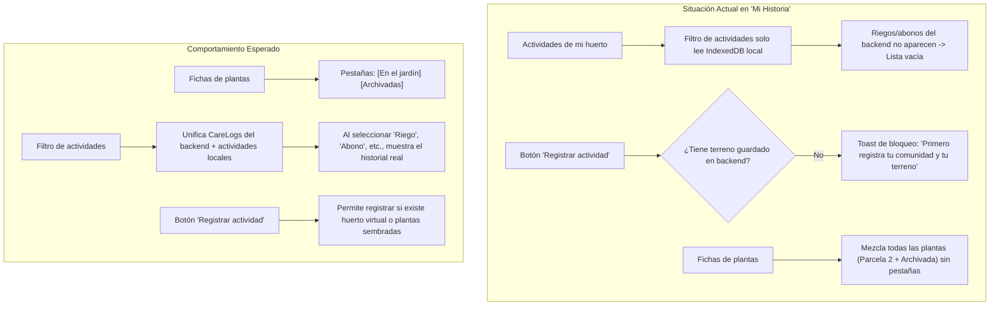

# 📋 Plan de Implementación: Pestañas de Plantas y Filtro de Actividades en "Mi Historia"

Este documento contiene la solución técnica y el **prompt de ejecución** para responder a los requerimientos identificados:

1. **Separar las plantas entre "En el jardín" y "Archivadas"** en la pestaña **"Mi historia"** (`GardenHistory.tsx`), con las mismas pestañas (`.journal-tabs`) que ya funcionan en el apartado de **"Mis plantas"** (`GardenPlants.tsx`).
2. **Hacer que el filtro de actividades funcione**:
   - Actualmente dice *"No hay actividades registradas para esta selección"* porque los riegos, abonos y cosechas guardados en el backend (`CareLog` y `HarvestRecord`) no se estaban unificando en la lista de `activities` de la pantalla.
   - Desbloquear el botón **"Registrar actividad"** para que no arroje el error *"Primero registra tu comunidad y tu terreno"* cuando el usuario ya tiene plantas registradas en su huerto.

---

## 🔍 Diagnóstico del Problema



---

## 🛠️ Especificación Técnica de Cambios

### 1. Pestañas en "Fichas de plantas" (`GardenHistory.tsx`)
- Incorporar el estado `const [archivedTab, setArchivedTab] = useState(false)`.
- Agregar el grupo de pestañas idéntico al de `GardenPlants.tsx`:
  ```tsx
  <div className="journal-tabs" role="group" aria-label="Estado de las fichas de plantas">
    <button type="button" aria-pressed={!archivedTab} onClick={() => setArchivedTab(false)}>
      En el jardín
    </button>
    <button type="button" aria-pressed={archivedTab} onClick={() => setArchivedTab(true)}>
      Archivadas
    </button>
  </div>
  ```
- Filtrar la lista de plantas mostradas:
  ```tsx
  const visiblePlants = plants.filter(plant => Boolean(plant.archivedAt) === archivedTab)
  ```
- Si la pestaña está vacía, mostrar mensaje amigable:
  - *"No hay plantas cultivándose actualmente en el jardín."* (si está en "En el jardín").
  - *"No hay fichas archivadas."* (si está en "Archivadas").

---

### 2. Integración de Actividades del Backend en el Filtro (`GardenHistory.tsx` & `App.tsx`)
- **Problema actual**: El filtro superior `<select>` solo busca en `journal.data.activities` (memoria local del navegador). Cuando el usuario registra un riego o abono desde el Pasaporte Vivo, este va a la base de datos `/api/plants/:id/care`, pero no aparecía en la lista superior de actividades.
- **Solución**:
  - Unificar las actividades mostradas: transformar los `CareLog` (Riegos, Abonos, Podas) y `HarvestRecord` (Cosechas) de las plantas del huerto en objetos compatibles con `GardenActivity`.
  - De esta forma, al filtrar por *"Riego"*, *"Abonado"*, *"Cosecha"* o *"Todas las actividades"*, el usuario verá inmediatamente los registros reales con sus fechas, notas y responsable.
  - Para actividades agrícolas manuales (ej: *"Limpieza y deshierbe"*, *"Aporque"*, *"Siembra"*), cuando no haya registros de esa categoría, se mostrará un mensaje descriptivo y la opción de registrar una.

---

### 3. Desbloqueo de "Registrar actividad" (`App.tsx`)
- En `openActivity(plant?: GardenPlant)`:
  - Actualmente exige `if (!realGarden || !communityRecord)`.
  - Si el usuario está autenticado y ya tiene plantas en `backendPlants` o tiene una comunidad activa (`activeCommunityId`), debe permitirle abrir el formulario de actividad asignándolo a la planta correspondiente sin bloquear con *"Primero registra tu comunidad y tu terreno"*.

---

## 💬 Prompt para Ejecutar la Corrección

Si estás de acuerdo con este plan, responde con:

> **ejecuta el plan de correccion de filtros y pestanas**
