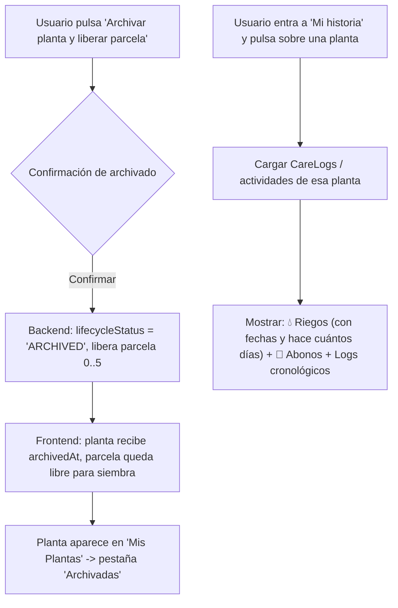

# 📋 Plan de Implementación: Unificación de Archivado de Plantas y Logs en "Mi Historia"

Este documento contiene la propuesta técnica y el **prompt de ejecución** para responder a los requerimientos solicitados:
1. **Unificar los botones "Desarraigar" y "Archivar"** en un solo botón claro en el Pasaporte Vivo (`PlantPassport.tsx`).
2. **Conservación en pestaña "Archivadas"**: Al archivar, la parcela se libera para un nuevo cultivo pero la planta no se borra; se muestra en el registro de **"Mis plantas"** en la pestaña **"Archivadas"**.
3. **Logs de cuidados en "Mi historia" (`GardenHistory.tsx`)**: Al hacer clic en cualquier planta, mostrar el historial detallado de veces que se regó con los días transcurridos, aplicaciones de abono, podas y observaciones en formato de bitácora/logs cronológicos.

---

## 🔍 Situación Actual vs. Solución Propuesta

| Aspecto | Comportamiento Actual | Comportamiento Deseado (Solución) |
|---|---|---|
| **Botones en Pasaporte Vivo** | Existen dos botones que compiten: *"🗑️ Desarraigar / Liberar parcela"* (que borra la planta de la BD) y *"Archivar ficha y liberar espacio"*. | **Un solo botón unificado**: **`📦 Archivar planta y liberar parcela`** con confirmación clara. |
| **Persistencia al liberar** | "Desarraigar" elimina la planta y sus cuidados en cascada de la base de datos. | **No se borra la planta ni sus cuidados**. Pasa a estado `ARCHIVED`, libera la parcela $0..5$ para un nuevo cultivo y se conserva en SQLite y memoria. |
| **Pestaña "Archivadas" en Mis Plantas** | Las plantas desarraigadas desaparecían del sistema. | La planta archivada aparece en **"Mis plantas"** en la pestaña **"Archivadas"**, permitiendo consultar su Pasaporte Vivo y fotos en cualquier momento. |
| **Pestaña "Mi historia"** | Muestra actividades genéricas globales y una lista simple de fichas de plantas. | Al hacer clic en una planta en **"Mi historia"**, se despliega el **historial específico de logs de cuidados**: total de riegos con días/fechas, aplicaciones de abono, podas y notas cronológicas. |

---

## 🛠️ Detalle de Componentes a Modificar



### 1. `PlantPassport.tsx` (Unificación de botones)
- **Eliminar** la sección redundante de *"Desarraigar / Liberar parcela"* que ejecutaba `plantApi.remove` (borrado físico).
- **Eliminar** el botón suelto de *"Archivar ficha y liberar espacio"*.
- **Crear un único botón principal de acción**:
  ```tsx
  <button type="button" onClick={() => setShowArchiveConfirm(true)} className="garden-archive-btn">
    📦 Archivar planta y liberar parcela
  </button>
  ```
- **Modal de confirmación claro**:
  > *"¿Deseas archivar esta planta? Se liberará la Parcela [X] para que puedas sembrar un nuevo cultivo en tu huerto. Toda su información, fotos y bitácora de riegos/abonos se conservarán en la pestaña 'Archivadas' de Mis Plantas."*
- Al confirmar, invoca el flujo de archivado conservando los datos y liberando el terreno.

### 2. Backend y Sincronización (`plant.service.ts` / `App.tsx`)
- En `backend/src/services/plant.service.ts`:
  - En lugar de `prisma.cultivatedPlant.delete`, actualizar `lifecycleStatus = 'ARCHIVED'` y asignar `plotIndex` negativo para liberar la parcela $0..5$ (cumpliendo con la restricción `UNIQUE [realGardenId, plotIndex]`).
  - Conservar íntegros todos los registros de `CareLog` asociados.
- En `App.tsx`:
  - La planta archivada permanece en el listado de plantas con `archivedAt: new Date().toISOString()`, lo que hace que `GardenPlants.tsx` la liste automáticamente en su pestaña **"Archivadas"**.

### 3. `GardenHistory.tsx` (Pestaña "Mi historia" con logs por planta)
- Al hacer clic en una ficha de planta en *"Mi historia"*:
  - Abrir un panel o vista detallada con los **Logs de cuidados de la planta**:
    - **Contador de riegos:** Número total de riegos y cuándo fue el último con cálculo relativo (ej. *"Riego · Realizado hace 2 días (06/11/2026)"*).
    - **Contador de abonos:** Aplicaciones de fertilizante orgánico, tipos de abono y fechas.
    - **Registro cronológico de actividades (Care Logs):** Lista ordenada con icono (💧 Riego, 🌿 Abono, ✂️ Poda, 🔍 Observación), fecha, notas del cuidador y responsable que ejecutó la acción.

---

## 🎯 Criterios de Aceptación

1. **Unificación visible:** Ya no existen dos botones confusos ("Desarraigar" y "Archivar"); solo existe uno: **`📦 Archivar planta y liberar parcela`**.
2. **Parcela libre:** Al archivar, la parcela en el huerto queda libre de inmediato para sembrar otra especie.
3. **Registro en "Archivadas":** Al ir a **"Mis plantas"** y seleccionar la pestaña **"Archivadas"**, la planta aparece en la lista con su foto, nombre y fecha.
4. **Logs en "Mi historia":** En la pestaña **"Mi historia"**, al seleccionar cualquier planta se despliega el registro histórico de riegos (con conteo y días), abonos y cuidados recibidos.
5. **Cero regresiones:** `npm run typecheck` = 0 errores, compilación limpia y 17/17 pruebas unitarias aprobadas.

---

## 🚀 Prompt para Autorizar la Ejecución

Para iniciar la implementación, puedes autorizarlo respondiendo con el siguiente texto:

> **"Ejecuta el plan de implementación: unifica los botones de desarraigar y archivar en el Pasaporte Vivo, asegura la persistencia en la pestaña de archivadas de Mis Plantas y agrega los logs cronológicos de riegos y abonos por planta en Mi Historia."**
