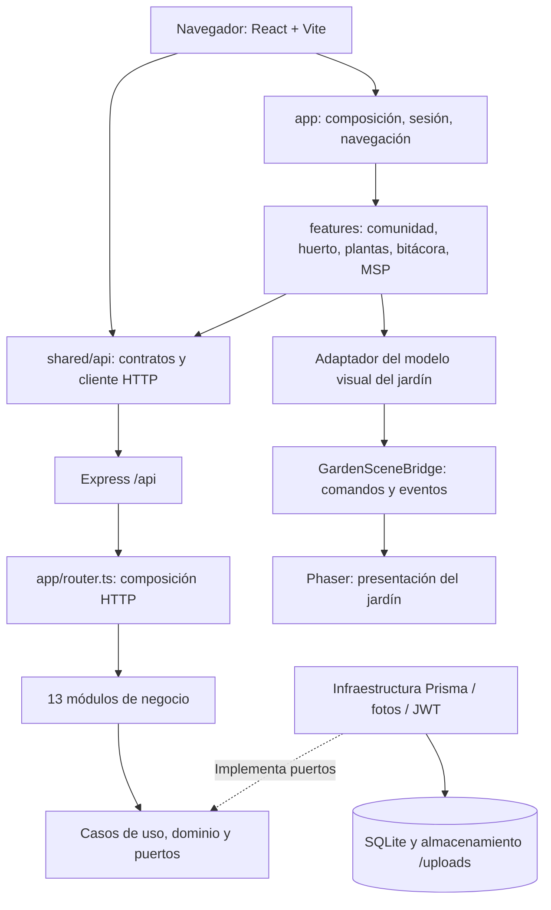
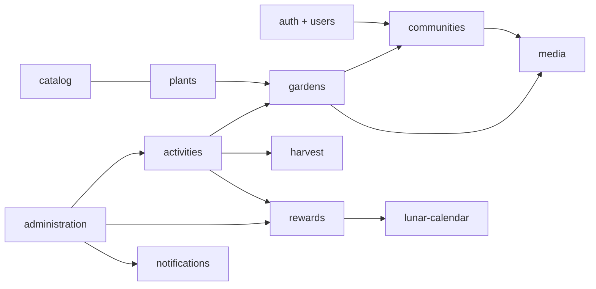

# Kawsapacha — Arquitectura implementada

## Contexto y límites

Repositorio único con `frontend/` (React, Vite, TypeScript, Phaser 3) y `backend/` (Express, Prisma, SQLite).
El backend se despliega como **un monolito modular**, en un solo proceso, no como microservicios.
La rama de refactorización no cambia contratos REST, reglas agrícolas, esquema Prisma ni rutas de fotografías.

## Mapa de componentes y dependencias

El segundo diagrama **resume colaboraciones relevantes**; no representa exhaustivamente todos los imports o rutas. No se debe interpretar como secuencia de transacciones.

## Inventario de módulos backend

| Área | Módulos |
| --- | --- |
| Identidad | `auth`, `users` |
| Comunidad y cultivo | `communities`, `gardens`, `plants`, `activities`, `harvest` |
| Apoyo agronómico | `catalog`, `lunar-calendar` |
| Institucional y transversal | `administration`, `rewards`, `notifications`, `media` |

Los 13 módulos están bajo `backend/src/modules/` con subcarpetas `domain/`, `application/`, `application/ports/`, `infrastructure/` y `presentation/` según su responsabilidad.

## Convenciones y reglas de dependencia

- `domain/`: reglas puras, sin Express, HTTP, Prisma ni almacenamiento.
- `application/`: casos de uso y puertos; las operaciones se prueban con repositorios simulados.
- `infrastructure/`: adaptadores Prisma, archivos, autenticación y detalles externos.
- `presentation/`: controladores, middlewares de borde y rutas; no deben consultar Prisma directamente.
- `*.module.ts`: punto de composición de dependencias. El router principal solo monta endpoints.
- `backend/src/shared/`: tipos y utilidades técnicas; no introducir reglas de negocio de módulos específicos.
- `frontend/src/app/`: navegación, sesión, ensamblaje y coordinación entre capacidades.
- `frontend/src/features/`: pantallas y operaciones por capacidad, incluidos `my-garden/plant-actions.ts` y `my-garden/journal/activity-actions.ts`.
- `frontend/src/shared/`: contrato y transporte HTTP, geografía y componentes compartidos; no importa `features/` ni `app/`.
- Phaser recibe snapshots, comandos y eventos por `adapter.ts`, `model.ts` y `bridge.ts`, sin acceso directo al cliente HTTP.
- Las cuatro fachadas de entrada antiguas se conservan **porque aún tienen consumidores comprobados**; no retirar reexportaciones sin auditoría.

El CI comprueba importaciones entre capas, ciclos backend, reglas frontend `shared → features/app`, `features → app` y **cualquier `feature → feature` directo**, y que el código de Phaser no importe el cliente HTTP. Las pruebas estáticas no equivalen a ausencia de todo acoplamiento semántico.

## Límites y excepciones documentadas

- La dependencia directa entre funcionalidades frontend se redujo de **78 a 0 imports** mediante contratos e iconos reutilizables, geografía, selectores, recursos visuales y catálogo en `shared`. El CI impide nuevas importaciones `feature → feature`. La coordinación de capacidades permanece en `app/`.
- Las secuencias de cosecha, inventario, evidencia, puntos y misiones no son íntegramente atómicas; ver [ADR-0002](ADR-0002-limites-transaccionales.md).
- La regresión automatizada y persistencia con SQLite temporal aprobó; las pruebas **con la instalación y datos privados reales** requieren revisión del equipo.
- No cambiar ni regenerar bases reales, ni reinicializar `/uploads`. Conservar los volúmenes de Docker.

## Decisiones y verificación

- [ADR-0001 — monolito modular y Clean Architecture](ADR-0001-monolito-modular.md)
- [ADR-0002 — límites transaccionales](ADR-0002-limites-transaccionales.md)
- [Pruebas y resultados de regresión](../quality/regresion-arquitectura.md)
- [Matriz de regresión y aceptación manual](../quality/regresion-arquitectura.md)
- [Contratos API previos](../arquitectura/contratos-api.md)

La implementación y sus cuatro workflows terminaron en éxito en el commit funcional `5e024893`, previo a este cambio documental. Ningún commit de documentación altera la lógica o los datos.
