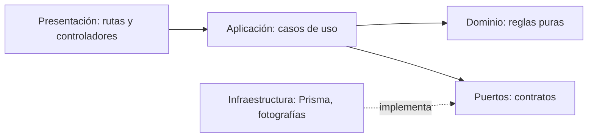

# Kawsapacha — Arquitectura objetivo (TO-BE)

## Contexto

Un solo repositorio: `frontend/` (React + Vite + TypeScript + Phaser) y `backend/` (Node.js + Express + Prisma). El backend continúa siendo **un único proceso desplegable**; la migración no introduce microservicios.

## Módulos de negocio

- Identidad: `auth`, `users`.
- Trabajo agrícola: `communities`, `gardens`, `plants`, `activities`, `harvest`, `lunar-calendar`, `catalog`.
- Institucional y experiencia: `administration` (MSP/técnico), `rewards`, `notifications`, `media`.

Las áreas visibles de la web (Mi Huerto, Comunidad, Mi Camino Verde, Notificaciones) **no** tienen por qué coincidir con estos límites internos.

## Capas y regla de dependencias

La composición HTTP vive en `backend/src/app/router.ts`. Las reglas puras no deben importar Express, Prisma ni archivos. Los casos de uso nuevos recibirán contratos inyectados por su módulo. `backend/src/infrastructure/` aporta configuración y la instancia Prisma; `backend/src/shared/` aporta utilidades técnicas realmente compartidas.

**Migración en curso:** inicialmente se conservaron servicios existentes bajo `application` para mantener funcionalidad. Algunos todavía llaman a Prisma y a otros servicios directamente. La estructura de carpetas por sí sola **no** demuestra que Clean Architecture esté completada.

## Invariantes que no se deben romper

- Misma interfaz, navegación, mapas, escenas Phaser, fotografías y bitácora.
- Mismos nombres, métodos, rutas y respuestas de la API REST.
- Mismas reglas existentes del MSP, recompensas, cosechas, misiones y comunidades; los cambios de producto se harán en PR distintos.
- Sin reescribir ni eliminar migraciones Prisma, datos reales, archivos de usuarios, evidencias o credenciales de despliegue.
- Preservar `/uploads`, su volumen Docker y la compatibilidad de scripts y CI.

Consultar también [arquitectura histórica](../arquitectura/backend.md), [frontend](../arquitectura/frontend.md) y [contratos](../arquitectura/contratos-api.md).
