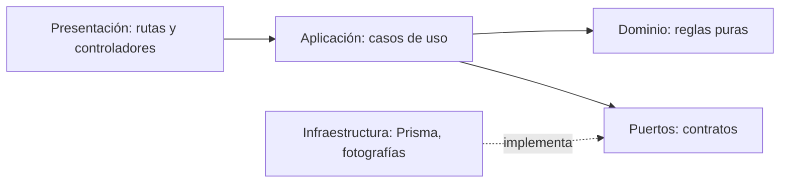

# Kawsapacha — Arquitectura objetivo (TO-BE)

## Contexto

Un solo repositorio: `frontend/` (React + Vite + TypeScript + Phaser) y `backend/` (Node.js + Express + Prisma). El backend continúa siendo **un único proceso desplegable**; la migración no introduce microservicios.

## Módulos de negocio

- Identidad: `auth`, `users`.
- Trabajo agrícola: `communities`, `gardens`, `plants`, `activities`, `harvest`, `lunar-calendar`, `catalog`.
- Institucional y experiencia: `administration` (MSP/técnico), `rewards`, `notifications`, `media`.

Las áreas visibles de la web (Mi Huerto, Comunidad, Mi Camino Verde, Notificaciones) **no** tienen por qué coincidir con estos límites internos.

## Capas y regla de dependencias

La composición HTTP vive en `backend/src/app/router.ts`. Las reglas puras no deben importar Express, Prisma ni archivos. Los casos de uso nuevos recibirán contratos inyectados por su módulo. `backend/src/infrastructure/` aporta configuración y la instancia Prisma; `backend/src/shared/` aporta utilidades técnicas realmente compartidas.

**Estado verificado:** la capa `application/` de los 13 módulos no importa Prisma, Express ni infraestructura, y los archivos `domain/` son independientes de infraestructura y HTTP. Los adaptadores de persistencia, fotografías y tokens están en `infrastructure/`, y las dependencias se ensamblan en archivos `*.module.ts`. El control estático obligatorio del CI rechaza importaciones indebidas y dependencias circulares; el último reporte confirmó **0 ciclos**.

## Invariantes que no se deben romper

- Misma interfaz, navegación, mapas, escenas Phaser, fotografías y bitácora.
- Mismos nombres, métodos, rutas y respuestas de la API REST.
- Mismas reglas existentes del MSP, recompensas, cosechas, misiones y comunidades; los cambios de producto se harán en PR distintos.
- Sin reescribir ni eliminar migraciones Prisma, datos reales, archivos de usuarios, evidencias o credenciales de despliegue.
- Preservar `/uploads`, su volumen Docker y la compatibilidad de scripts y CI.

## Revisión y excepciones

- [ADR-0001: decisión de monolito modular](ADR-0001-monolito-modular.md)
- [ADR-0002: límites transaccionales y excepciones](ADR-0002-limites-transaccionales.md)
- [Auditoría de fronteras](auditoria-fronteras-2026-11-15.md)
- [Ejecución de la Fase 1](../quality/fase-1-arquitectura-pr72.md)

Las transacciones actuales de anulación y revisión MSP se mantienen; los flujos multioperación de actividades, cosechas e inventario todavía requieren pruebas de rollback para justificar una nueva unidad de trabajo. La fase arquitectónica no debe afirmar atomicidad que no existe.

Consultar también [arquitectura histórica](../arquitectura/backend.md), [frontend](../arquitectura/frontend.md) y [contratos](../arquitectura/contratos-api.md).
