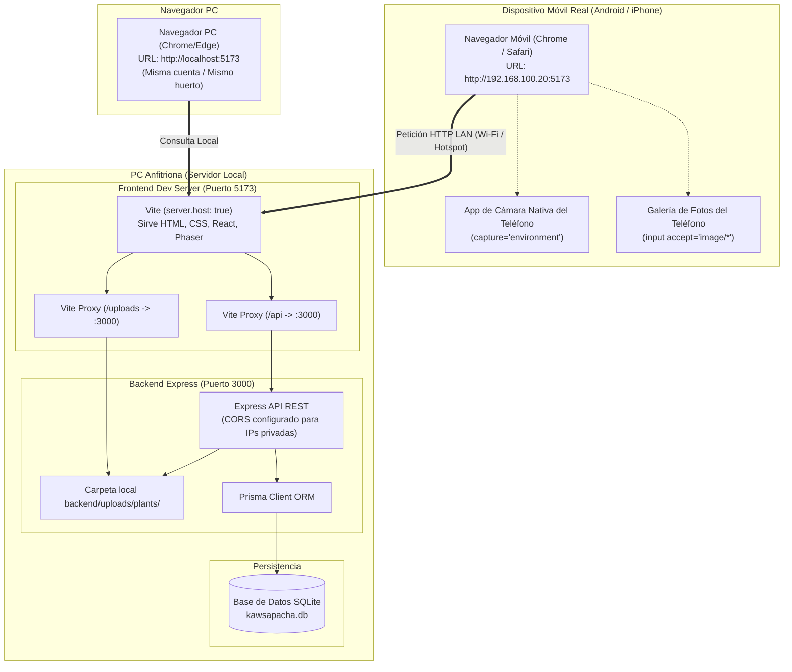

# Arquitectura de Acceso Móvil y Guía de Conexión LAN (Demo V1)

**Hito:** V1 - Demo Presencial (10/11/2026)  
**Módulo / Issue:** MOB-001 (#34)  
**Responsable:** @Rodni15 (backend/red/API)  
**Coordinación:** @ItsLeonel (frontend/Phaser) · **QA:** @TonyTiago · **Documentación:** @kened-leonardo  

---

## 1. Visión General del Flujo Multidispositivo

El objetivo de esta arquitectura es permitir que durante la demostración presencial se complete con éxito el flujo:
$$\text{Móvil (Cámara/Galería)} \longrightarrow \text{Cuenta / Huerto} \longrightarrow \text{Persistencia SQLite} \longrightarrow \text{Consulta en Computadora}$$

La aplicación **Kawsapacha V1 es una web adaptable (responsive)**; no requiere compilar ni instalar APKs nativos. Se ejecuta y aloja en la **PC anfitriona** y se accede desde el navegador de un celular real (Android o iOS) conectado a la misma red local.

---

## 2. Diagrama de Arquitectura de Red y Servicios



---

## 3. Prerrequisitos y Configuración en la PC Anfitriona

### 3.1 Servidores en Ejecución
Ambos servicios deben correr simultáneamente en la PC anfitriona:
1. **Backend (API + SQLite):**
   ```powershell
   cd OptiCode-Kawsapacha/backend
   npm run dev
   ```
   *Verificar salud:* `http://localhost:3000/api/health` debe responder `{"status":"ok","db":"connected"}`.
2. **Frontend (Vite):**
   ```powershell
   cd OptiCode-Kawsapacha/frontend
   npm run dev
   ```
   *Verificar consola:* Vite mostrará las URLs locales y de red:
   ```
   ➜  Local:   http://localhost:5173/
   ➜  Network: http://<IP_LOCAL_PC>:5173/
   ```

### 3.2 Detección de la IP Local de la PC
En la terminal de la PC (PowerShell), ejecutar:
```powershell
ipconfig
```
Buscar el adaptador de red activo (por ejemplo, `Adaptador de LAN inalámbrica Wi-Fi`):
- **Dirección IPv4:** Ejemplo: `192.168.100.20`.
- **URL para el celular:** `http://192.168.100.20:5173`.

> [!IMPORTANT]
> **Nunca abrir `localhost` desde el teléfono:** El teléfono buscaría el servidor dentro de sí mismo. Se debe ingresar siempre la dirección IP de la PC con el puerto 5173.

### 3.3 Regla de Firewall de Windows (Si el móvil no conecta)
Si al ingresar la URL desde el celular la página se queda cargando o da tiempo de espera agotado, Windows Defender Firewall está bloqueando el puerto `5173`. Para permitir la entrada en PowerShell como Administrador:
```powershell
New-NetFirewallRule -DisplayName "Kawsapacha Vite Dev" -Direction Inbound -LocalPort 5173 -Protocol TCP -Action Allow
```
*(No es necesario exponer el puerto 3000 ni la base de datos a Internet).*

---

## 4. Solución Técnica para la Cámara en Dispositivos Móviles

### 4.1 El Problema de `getUserMedia` en HTTP
Por especificación estricta de seguridad web (W3C), la API `navigator.mediaDevices.getUserMedia` **únicamente funciona en contextos seguros (`https://` o `http://localhost`)**.  
Cuando un celular abre una IP de red local (`http://192.168.x.x:5173`), el navegador móvil clasifica la conexión como **contexto no seguro** y desactiva el acceso a la cámara mediante stream de video directo, arrojando errores como `SecurityError` o `NotAllowedError`.

### 4.2 La Solución Implementada: Captura Nativa HTML5
Para la demo V1 se implementó la **Opción B recomendada**:
```html
<input
  ref={cameraInputRef}
  type="file"
  accept="image/jpeg,image/png,image/webp,image/*"
  capture="environment"
  class="plant-sr-only"
/>
```
- **Comportamiento en celular:** Al presionar el botón **"Cámara"**, Kawsapacha detecta que la conexión no cuenta con contexto seguro y dispara directamente el input nativo con `capture="environment"`.
- **Experiencia de usuario:** El sistema operativo del celular (Android o iOS) abre la **aplicación de cámara nativa** usando la lente trasera. El usuario toma la fotografía con el autoenfoque y calidad propios de su dispositivo, confirma y la foto entra de inmediato al formulario de registro de la planta.
- **Opción de Galería preservada:** El botón **"Galería"** abre el selector de archivos estándar para subir fotos tomadas previamente.
- **Optimización automática cliente-lado:** Los sensores de teléfonos actuales generan fotos de alta resolución ($>12\text{ MP}$, entre $4$ y $8\text{ MB}$). Un helper en Canvas escala automáticamente la imagen a un máximo de $1920\text{ px}$ y compresión JPEG $0.85$, garantizando que el archivo final pese entre $300\text{ KB}$ y $800\text{ KB}$ (cumpliendo el límite estricto de $3\text{ MB}$ del backend).

---

## 5. Plan de Contingencia para Wi-Fi Universitario (AP Isolation)

En redes Wi-Fi institucionales o de campus universitario, es muy frecuente que los administradores activen el **aislamiento de clientes (Client Isolation / AP Isolation)**. Esto impide que dos dispositivos conectados a la misma red Wi-Fi se vean o comuniquen entre sí (bloquea el tráfico entre el celular y la PC).

### Procedimiento de Contingencia (Hotspot / Zona Wi-Fi Portátil):
1. **Opción A (Hotspot desde Windows):**
   - En la PC anfitriona, ir a **Configuración $\rightarrow$ Red e Internet $\rightarrow$ Zona con cobertura inalámbrica móvil (Mobile Hotspot)**.
   - Activar la zona Wi-Fi compartida y anotar el nombre de red y contraseña.
   - Conectar el celular a esa red creada por la PC.
   - Ejecutar `ipconfig` en la PC (tomar la IP del adaptador de Hotspot, comúnmente `192.168.137.1`).
   - Abrir en el celular: `http://192.168.137.1:5173`.
2. **Opción B (Hotspot desde el Celular):**
   - Activar "Punto de acceso móvil / Compartir Internet" en el celular.
   - Conectar la PC a la red Wi-Fi del celular.
   - Ejecutar `ipconfig` en la PC para ver la IP asignada (ejemplo: `192.168.43.15`).
   - Abrir en el celular: `http://192.168.43.15:5173`.

Ambas opciones garantizan tráfico directo sin intermediarios, cortafuegos externos ni necesidad de conexión a Internet.

---

## 6. Protocolo de Prueba Demostrativa (Paso a Paso)

1. **PC:** Iniciar sesión con la cuenta de demostración (`ronny@kawsapacha.org` o cuenta creada).
2. **Celular:** Abrir `http://<IP_PC>:5173` e iniciar sesión con la misma cuenta.
3. **Celular:** Ir a **Mi Jardín**, pulsar una parcela vacía (por ejemplo, Espacio 2) o "Registrar planta".
4. **Celular:** Presionar **"Cámara"**, tomar la foto a una planta real, seleccionar la especie (ej. *Menta*) y guardar.
5. **PC:** Visualizar inmediatamente (o tras pulsar F5 si no hay polling automático) el huerto en la PC: la Parcela 2 muestra la fotografía real capturada desde el teléfono, su Pasaporte Vivo y opciones de cuidado.
