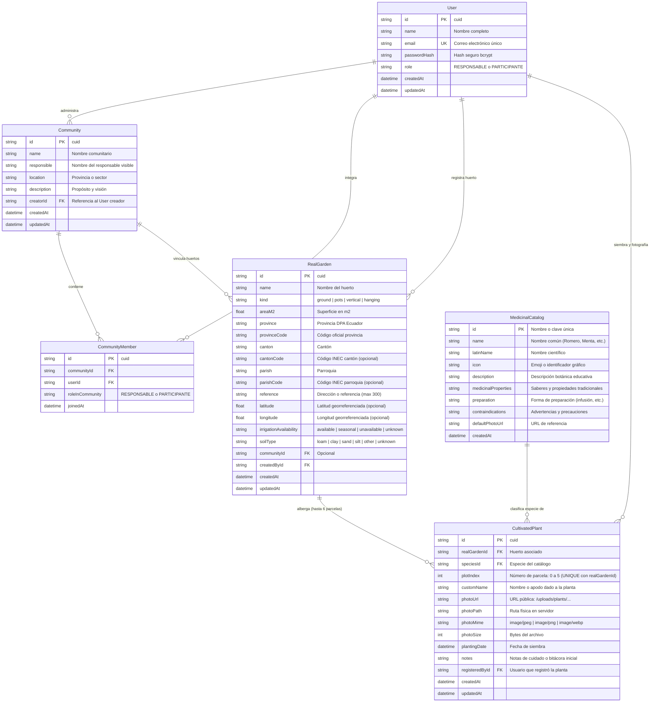

# Arquitectura del Backend — Kawsapacha V1

**Responsable:** Ronny Veloz (`Rodni15`) — Backend Developer, Base de Datos y Arquitectura  
**Issue:** [#4 ARQ-001](https://github.com/ItsLeonel/OptiCode-Kawsapacha/issues/4) / [#7 DEV-002](https://github.com/ItsLeonel/OptiCode-Kawsapacha/issues/7)  
**Milestone:** M1 — Análisis y Diseño V1 / M2 — Desarrollo Funcional V1  

---

## 1. Visión General de la Arquitectura

El backend de Kawsapacha V1 está concebido como una **API REST desacoplada, stateless y fuertemente tipada** desarrollada con **Node.js 22 LTS, Express y TypeScript**, con persistencia relacional en **SQLite** mediante **Prisma ORM**.

Sigue una **arquitectura por capas (Layered Architecture)** con separación estricta de responsabilidades:
- **Capa de Enrutamiento y Middleware (`src/routes/`, `src/middlewares/`):** Validación de peticiones, autenticación JWT, subida de archivos multipart (`multer`), y manejo centralizado de errores.
- **Capa de Controladores (`src/controllers/`):** Recepción de requests HTTP, extracción y sanitización de parámetros, orquestación de respuestas estandarizadas `{ ok, message, data }`.
- **Capa de Lógica de Negocio y Servicios (`src/services/`):** Reglas del dominio, hashing de credenciales, límites de parcelas (0 a 5), asignación de huertos y transacciones.
- **Capa de Persistencia y Acceso a Datos (`prisma/`, `src/config/prisma.ts`):** Esquema declarativo de base de datos, consultas optimizadas, tipos generados automáticamente y control de integridad referencial.
- **Almacenamiento Físico de Evidencias (`uploads/plants/`):** Almacenamiento local en disco de fotos reales de cultivos con URLs relativas servidas estáticamente.

```text
┌─────────────────────────────────────────────────────────┐
│               Frontend (React 19 + Vite)                │
└────────────────────────────┬────────────────────────────┘
                             │ HTTP / JSON / multipart
                             ▼
┌─────────────────────────────────────────────────────────┐
│               Express Application Pipeline              │
│  Helmet ──► CORS ──► JSON Parser ──► Static (/uploads)  │
└────────────────────────────┬────────────────────────────┘
                             │
     ┌───────────────────────┼───────────────────────┐
     ▼                       ▼                       ▼
┌──────────────┐      ┌──────────────┐      ┌──────────────┐
│ Auth Routes  │      │ Garden/Plant │      │   Catalog    │
│ & Middleware │      │ & Upload MW  │      │    Routes    │
└──────┬───────┘      └──────┬───────┘      └──────┬───────┘
       ▼                     ▼                     ▼
┌──────────────┐      ┌──────────────┐      ┌──────────────┐
│ Auth Service │      │ Garden/Plant │      │   Catalog    │
│  (bcrypt/JWT)│      │   Service    │      │   Service    │
└──────┬───────┘      └──────┬───────┘      └──────┬───────┘
       │                     │ (Multer: disk)      │
       │                     ▼                     │
       │              ┌──────────────┐             │
       │              │uploads/plants│             │
       │              └──────────────┘             │
       └─────────────────────┬─────────────────────┘
                             ▼
              ┌─────────────────────────────┐
              │      Prisma ORM Client      │
              └──────────────┬──────────────┘
                             ▼
              ┌─────────────────────────────┐
              │    SQLite (kawsapacha.db)   │
              └─────────────────────────────┘
```

---

## 2. Selección y Justificación de Tecnologías

| Componente | Tecnología Seleccionada | Justificación Técnica |
|---|---|---|
| **Runtime** | Node.js 22 LTS | Entorno asíncrono y de alto rendimiento. Mantiene paridad con la versión usada en el flujo de CI (`.github/workflows/frontend-ci.yml`). |
| **Lenguaje** | TypeScript (~5.6) | Garantiza tipado estático estricto (`strict: true`), evitando errores en tiempo de ejecución y asegurando compatibilidad directa con los tipos del frontend de Leonel. |
| **Framework Web** | Express.js 4 / 5 | Minimalista, maduro, extensible y estándar para la especificación del curso. Facilita la configuración de CORS, cabeceras Helmet y middlewares modulares. |
| **Motor de Base de Datos** | **SQLite** (`prisma/kawsapacha.db`) | **Decisión técnica acordada:** Almacenamiento embebido en un único archivo. Elimina por completo la necesidad de configurar servidores externos (como PostgreSQL) o contenedores Docker en las máquinas locales de los integrantes (Frontend, Documentación y QA). Cumple con integridad ACID completa, claves foráneas e índices. |
| **ORM / Data Mapper** | Prisma ORM 5.22 | Modelo declarativo centralizado (`schema.prisma`), migraciones versionadas y reproducibles, cliente TypeScript con autocompletado y tipado seguro. Facilita migrar a PostgreSQL en versiones futuras sin alterar la lógica de negocio. |
| **Seguridad de Contraseñas** | `bcryptjs` (Salt = 10) | Algoritmo estándar adaptativo de hashing con sal para almacenamiento no reversible de contraseñas. |
| **Sesiones y Tokens** | `jsonwebtoken` (JWT) | Autenticación stateless mediante tokens firmados enviados en la cabecera `Authorization: Bearer <token>`. Permite verificar roles (`RESPONSABLE`, `PARTICIPANTE`) en el backend sin consultas constantes a sesión en memoria. |
| **Carga de Archivos** | `multer` 2.x | Almacenamiento en disco (`backend/uploads/plants/`) con nombres únicos seguros. Validación estricta de tipo MIME (`image/jpeg`, `image/png`, `image/webp`) y límite de tamaño ($\le 3$ MB). En la base de datos solo se guardan la URL y los metadatos. |

---

## 3. Modelo de Datos Relacional (DER)

El esquema de persistencia en SQLite modela las entidades requeridas para los 5 módulos funcionales de V1:



### Reglas de Integridad y Restricciones
1. **Unicidad de Parcela por Huerto:** Restricción `@@unique([realGardenId, plotIndex])`. No es posible que dos registros ocupen la misma parcela en un mismo huerto real.
2. **Capacidad del Huerto Virtual:** El índice `plotIndex` está restringido en el rango estricto de $0 \le \text{plotIndex} \le 5$, concordando con la cuadrícula de 6 camas de cultivo del frontend.
3. **Persistencia de Archivos:** Las imágenes subidas por el usuario se nombran con el patrón `plant-<timestamp>-<hash>.<ext>` para evitar colisiones en el sistema de archivos.

---

## 4. Estructura del Código Fuente

```text
backend/
├── prisma/
│   ├── schema.prisma           # Esquema relacional y modelos
│   ├── seed.ts                 # Seeder de las 8 especies medicinales
│   ├── migrations/             # Migraciones SQL ejecutadas
│   └── kawsapacha.db           # Archivo de base de datos SQLite
├── src/
│   ├── config/
│   │   ├── env.ts              # Carga y validación de variables de entorno
│   │   └── prisma.ts           # Cliente singleton de Prisma
│   ├── controllers/
│   │   ├── auth.controller.ts  # Registro, login y perfil
│   │   ├── community.controller.ts # CRUD de comunidades
│   │   ├── garden.controller.ts    # Registro y consulta de huertos reales
│   │   ├── catalog.controller.ts   # Consulta de catálogo medicinal
│   │   └── plant.controller.ts     # Huerto virtual y Pasaporte Vivo
│   ├── middlewares/
│   │   ├── auth.middleware.ts  # Verificación de JWT
│   │   ├── upload.middleware.ts# Multer para fotos (<3MB, JPG/PNG/WebP)
│   │   └── error.middleware.ts # Manejo global de excepciones
│   ├── routes/
│   │   ├── auth.routes.ts
│   │   ├── community.routes.ts
│   │   ├── garden.routes.ts
│   │   ├── catalog.routes.ts
│   │   ├── plant.routes.ts
│   │   └── index.ts            # Agrupador central de rutas /api
│   ├── services/
│   │   ├── auth.service.ts
│   │   ├── community.service.ts
│   │   ├── garden.service.ts
│   │   ├── catalog.service.ts
│   │   └── plant.service.ts
│   ├── types/
│   │   └── index.ts            # Definiciones e interfaces TypeScript
│   ├── utils/
│   │   ├── jwt.ts              # Firma y validación de tokens
│   │   └── response.ts         # Respuestas HTTP homogéneas
│   └── app.ts                  # Servidor Express y middlewares
├── uploads/
│   └── plants/                 # Directorio de fotos guardadas
├── .env.example                # Plantilla de configuración
├── package.json
└── tsconfig.json
```

---

## 5. Medidas de Seguridad y Calidad

1. **Protección de Datos Sensibles:** Las contraseñas nunca se guardan en texto plano; se procesan con `bcryptjs`. Los payloads de respuesta omiten el hash de contraseña.
2. **Mensajes de Error Seguros:** El endpoint de login retorna `"Correo o contraseña incorrectos"` de forma genérica para mitigar ataques de enumeración de usuarios.
3. **Límites de Carga:** Prevención de ataques DoS por carga de archivos limitando el tamaño a 3 MB y validando la extensión y MIME type.
4. **Verificación de Salud:** Endpoint `/api/health` ejecuta una consulta en vivo a SQLite (`SELECT 1`) para monitorización continua.
