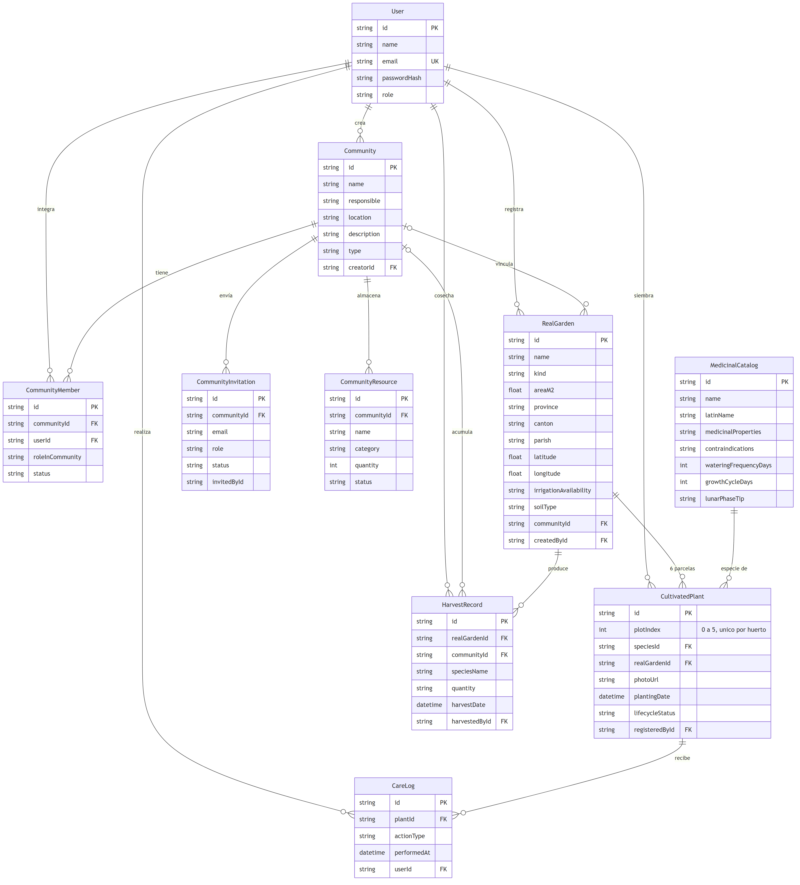

# Proyecto Versión 1 · Kawsapacha: Mi Huerto Vivo

> **Borrador del informe final** (`Proyecto-Version1-OptiCode.pdf`). Redacta: Leonardo Lugmaña. Revisa y entrega: Leonel Morales.
> Las partes marcadas como **[PENDIENTE]** esperan insumos de otros integrantes y no deben completarse con supuestos. Estructura y fuentes en el [esquema del informe](esquema-informe-v1.md).

---

## Portada

**Escuela Politécnica Nacional**
ISWD652 Calidad de Software · Período 2026B
**Proyecto:** Huertos Medicinales Comunitarios: Kawsapacha, Mi Huerto Vivo (Versión 1)
**Equipo:** OptiCode
**Fecha de entrega:** 10 de noviembre de 2026

| Integrante | Rol | Usuario GitHub |
|---|---|---|
| Leonel Morales | Project Manager y desarrollo frontend | `ItsLeonel` |
| Ronny Veloz | Backend, base de datos y arquitectura | `Rodni15` |
| Dylan Maldonado | Diseño UI/UX | `DylanIMM` |
| Leonardo Lugmaña | Análisis de requisitos y documentación | `kened-leonardo` |
| Santiago Guamán | Aseguramiento de calidad y pruebas | `TonyTiago` |

Repositorio: https://github.com/ItsLeonel/OptiCode-Kawsapacha

---

## 1. Introducción

El Ministerio de Salud Pública del Ecuador (MSP) planteó, como cliente del proyecto, una aplicación web educativa que motive a las comunidades a crear y mantener huertos medicinales, usando gamificación para generar una competencia sana entre ellas. La definición del proyecto pide registrar las comunidades de siembra y sus integrantes, el huerto real de cada comunidad con su ubicación y características, la bodega, las actividades de cultivo según el calendario lunar y los saberes ancestrales, un huerto virtual que refleje el avance del huerto real y un foro moderado.

Llamamos a la aplicación *Kawsapacha* porque en kichwa significa «mundo vivo» o «naturaleza viva», y los lineamientos del MSP la presentan como la ley natural según la cual «todo es vivo y con inteligencia propia» (MSP, 2017, p. 7). La idea de fondo es que cada planta registrada en la aplicación corresponda a una planta real, con su fotografía, su ficha (que llamamos *Pasaporte Vivo*) y el historial de cuidados que recibe.

Este informe describe la primera versión: cómo analizamos los requisitos, qué historias de usuario resultaron, la arquitectura y las tecnologías del producto, el código entregado, las pruebas realizadas y las limitaciones que quedan para los siguientes incrementos.

---

## 2. Análisis de requisitos

### 2.1 Revisión de la definición del proyecto

Leímos la definición completa y separamos sus requisitos en dos grupos: los que sostienen el flujo principal (cuentas, comunidades, huerto real, catálogo de plantas y huerto virtual) y los que dependen de ese flujo para tener sentido, como el ranking, el foro o la certificación de talentos. Con esa división el Project Manager fijó cinco módulos para la V1 (sección 3). Al revisar la definición también aparecieron requisitos ambiguos, que registramos aparte para no resolverlos por intuición (sección 2.4).

### 2.2 Estudio de los lineamientos del MSP

El documento de referencia de la definición es *Implementación de huertos medicinales en los establecimientos de salud del primer nivel de atención. Lineamientos* (MSP, 2017). Lo revisamos buscando solo lo que afecta a la aplicación: validaciones, opciones de los formularios y contenido educativo. El resumen completo, con páginas citadas, está en [lineamientos-msp-aplicados.md](../analisis/lineamientos-msp-aplicados.md). Lo más útil para el producto fue lo siguiente.

La Tabla 1 del MSP (p. 24) define seis tipos de suelo (arcilloso, limoso, arenoso, margoso, gredoso y pantanoso), que son los mismos que pide la definición y que tomamos como referencia para el formulario del huerto. El MSP recomienda huertos de 16 a 400 m² (p. 23) y, para la región insular, solo huertos alternativos como colgantes o en macetas por la fragilidad ecológica de Galápagos (p. 20). Las fases lunares orientan cada actividad: la luna oscura sirve para preparar el suelo y deshierbar, el cuarto creciente para sembrar, la luna llena para cosechar hojas y flores, y el cuarto menguante para cosechar semillas y raíces (p. 69). El Anexo 5 clasifica las plantas en calientes y frescas, lo que nos permitió dar fuente a la cualidad de siete de las ocho especies del catálogo: romero, manzanilla, menta, toronjil, hierbabuena y orégano son calientes, y el llantén es fresco. La lavanda no aparece en esa lista.

El MSP también deja claro que la prescripción de plantas medicinales corresponde al personal de salud (p. 56). Por eso la aplicación presenta los usos de cada planta como información educativa y no como recomendación médica.

### 2.3 Actores

| Actor | Qué hace en el sistema |
|---|---|
| Visitante | Explora la aplicación sin cuenta; sus registros quedan solo en su navegador. |
| Participante | Pertenece a una comunidad; registra plantas, actividades y cosechas. |
| Responsable de comunidad | Crea y edita la comunidad, invita integrantes, asigna roles y registra el huerto real. |
| Moderador o administrador MSP | Previsto en la definición para el foro y el ranking; queda fuera de la V1. |

### 2.4 Preguntas abiertas al cliente y decisiones

El equipo no conserva el acta ni la presentación del taller de definición del alcance, así que en este informe no se atribuye ninguna respuesta al cliente. Lo que sí hicimos fue listar las preguntas que quedaron abiertas al analizar la definición y, para cada una, la decisión provisional que tomó el equipo para poder avanzar. Algunos ejemplos: no se define con qué criterio se ordena el ranking de comunidades, ni quién certifica los talentos de un integrante, ni cuántos puntos hacen falta para pasar de Aprendiz a Oficial y a Maestro (el equipo propuso 0, 100 y 300 puntos como regla local). Las trece preguntas están en [preguntas-al-cliente.md](../analisis/preguntas-al-cliente.md) y las decisiones internas pendientes en [dudas-y-decisiones-pendientes.md](../analisis/dudas-y-decisiones-pendientes.md).

### 2.5 Uso de inteligencia artificial

Para el análisis usamos Claude (Anthropic) como asistente: ayudó a resumir los lineamientos del MSP, a contrastar la definición con el código existente y a redactar los borradores de las historias de usuario, que luego revisó el analista frente a los documentos originales y al código. Varios planes de implementación del equipo, publicados en `docs/PLAN_*.md`, también se prepararon con asistentes de IA. **[PENDIENTE: confirmar con cada integrante qué herramientas de IA usó y para qué.]**

---

## 3. Alcance de la Versión 1

El Project Manager fijó cinco módulos funcionales para la primera entrega:

| Módulo | Contenido en la V1 |
|---|---|
| Usuarios | Registro, inicio y cierre de sesión, modo visitante y roles básicos. |
| Comunidades | Creación y edición, tipo de comunidad (personal, familiar, condominio, barrial), responsable e integrantes. |
| Huertos reales | Registro y edición del huerto con provincia elegida en un mapa interactivo del Ecuador, cantón, parroquia, ubicación exacta opcional y características. |
| Catálogo medicinal | Consulta de las especies con su ficha educativa. |
| Huerto virtual | Escenario 2D con seis parcelas, registro de plantas con foto real, Pasaporte Vivo, actividades y progreso. |

Al integrar el backend el 8 de noviembre entraron además funciones que la definición pide y que estaban previstas para después: invitación de integrantes con notificaciones, almacén comunitario (la bodega de la definición), registro de cosechas y un calendario de siembra por especie con consejo lunar. Quedan para incrementos posteriores los rituales de siembra y cosecha, el secado y etiquetado de plantas, el foro con moderación, el ranking entre comunidades, los retos validados por el servidor y la historia visual con videos. Detalle en [alcance-v1.md](../analisis/alcance-v1.md).

---

## 4. Historias de usuario

Redactamos 23 historias de usuario con la plantilla oficial del curso: número, título, prioridad, estimación en horas, la historia en formato «Como… quiero… para…», criterios de aceptación en formato «Dado… cuando… entonces…» con escenarios ideales y excepcionales, y las tareas de implementación con sus horas. Las estimaciones las hizo el analista y están pendientes de validar con los desarrolladores.

| Nro | Título | Prioridad | Horas |
|---|---|---|---:|
| HU-001 | Registrar una cuenta | Alta | 15 |
| HU-002 | Iniciar sesión | Alta | 11 |
| HU-003 | Cerrar sesión | Media | 5 |
| HU-004 | Explorar Kawsapacha como visitante | Media | 7 |
| HU-005 | Registrar una comunidad de siembra | Alta | 13 |
| HU-006 | Actualizar la comunidad | Alta | 7 |
| HU-007 | Invitar integrantes y gestionar sus roles | Alta | 14 |
| HU-008 | Registrar el huerto real eligiendo la provincia en el mapa | Alta | 13 |
| HU-009 | Detallar la ubicación del huerto | Media | 13 |
| HU-010 | Registrar las características del huerto | Alta | 12 |
| HU-011 | Actualizar el huerto real | Alta | 6 |
| HU-012 | Consultar el catálogo de plantas medicinales | Alta | 9 |
| HU-013 | Consultar la ficha botánica de una especie | Media | 15 |
| HU-014 | Visualizar mi huerto virtual | Alta | 24 |
| HU-015 | Registrar una planta con fotografía real | Alta | 12 |
| HU-016 | Consultar y actualizar el Pasaporte Vivo | Alta | 12 |
| HU-017 | Registrar actividades de cultivo | Media | 13 |
| HU-018 | Consultar mi progreso (Mi camino verde) | Media | 12 |
| HU-019 | Conservar mis registros | Alta | 11 |
| HU-020 | Responder invitaciones a una comunidad | Media | 8 |
| HU-021 | Gestionar el almacén comunitario (bodega) | Baja | 12 |
| HU-022 | Registrar la cosecha de una planta | Media | 10 |
| HU-023 | Consultar el calendario de siembra de una especie | Baja | 7 |
| | **Total** | | **271** |

Las fichas completas están en [historias-usuario-v1.md](../historias-usuario/historias-usuario-v1.md). **[Para el Word: copiar cada HU en la tabla de la plantilla oficial.]**

---

## 5. Arquitectura y diseño técnico

### 5.1 Vista general

Kawsapacha es una aplicación web de dos partes. El frontend, hecho con React y TypeScript, se ejecuta en el navegador y dibuja el huerto virtual con el motor Phaser. El backend es una API REST en Node.js con Express que guarda los datos en una base SQLite a través de Prisma. Cuando el usuario inicia sesión, todo lo que registra viaja a la API y queda en el servidor; si entra como visitante, la aplicación funciona igual pero guarda los datos en el propio navegador con IndexedDB. Ese modo híbrido permite mostrar la aplicación sin cuenta y, al mismo tiempo, tener persistencia real para los usuarios registrados.

```text
Navegador (React 19 + Phaser)  ──HTTP/JSON──►  API REST (Express)  ──Prisma──►  SQLite
        │                                             │
        └─ modo visitante: IndexedDB                  └─ fotos: backend/uploads/plants/
```

### 5.2 Backend por capas

Ronny organizó el backend en capas con responsabilidades separadas: las rutas y los *middlewares* validan la petición, comprueban el token y el rol del usuario y reciben las fotos; los controladores extraen los datos y arman respuestas con un formato único (`{ ok, message, data }`); los servicios contienen las reglas del negocio, como el límite de seis parcelas o el control de exceso de riego; y Prisma se encarga del acceso a la base. Detalle en [backend.md](../arquitectura/backend.md).

### 5.3 Modelo de datos



*Figura 1. Modelo entidad-relación de la base de datos (fuente: `backend/prisma/schema.prisma`; código del diagrama en [der-v1.mmd](der-v1.mmd)).*

| Entidad | Representa |
|---|---|
| `User` | Cuenta de usuario con correo único y contraseña cifrada. |
| `Community` | Comunidad de siembra, con nombre, responsable, ubicación, descripción y tipo. |
| `CommunityMember` | Pertenencia de un usuario a una comunidad, con su rol y estado. |
| `CommunityInvitation` | Invitación pendiente, aceptada o rechazada. |
| `RealGarden` | Huerto real con ubicación (provincia, cantón, parroquia, coordenadas) y características. |
| `MedicinalCatalog` | Especie medicinal con su ficha educativa y datos de calendario. |
| `CultivatedPlant` | Planta sembrada en una de las seis parcelas, con foto y estado de su ciclo. |
| `CareLog` | Registro de un cuidado (riego, abono, poda, control de plagas). |
| `HarvestRecord` | Registro de una cosecha. |
| `CommunityResource` | Herramienta, insumo o semilla del almacén comunitario. |

Una restricción única sobre huerto y parcela impide que dos plantas ocupen el mismo espacio.

### 5.4 Contratos de API

La API expone, entre otros, los grupos `/api/auth`, `/api/communities` (con integrantes, recursos y cosechas), `/api/invitations`, `/api/gardens`, `/api/catalog` y `/api/plants` (con Pasaporte Vivo, cuidados y cosecha), además de `/api/health` para comprobar el servicio. Las rutas, los cuerpos de petición y los códigos de error están en [contratos-api.md](../arquitectura/contratos-api.md).

### 5.5 Seguridad

Las contraseñas se guardan con `bcrypt` y nunca se devuelven en las respuestas. La sesión usa tokens JWT. El inicio de sesión responde siempre «Correo o contraseña incorrectos», sin decir cuál de los dos falló, para no revelar qué correos existen. Las acciones de administración de la comunidad (editar, invitar, cambiar roles, quitar integrantes, archivar plantas) solo las puede hacer el Responsable. Las fotos se limitan a JPG, PNG o WebP de hasta 3 MB, y la aplicación nunca pide la ubicación del dispositivo.

---

## 6. Diseño UI/UX

**[PENDIENTE: insumo de Dylan. Enlace al prototipo en Figma, guía visual (colores, tipografía, componentes), capturas reales del producto separadas de los mockups y decisiones de identidad regional para Costa, Sierra, Amazonía y Galápagos. Antes de redactar, actualizar el repositorio.]**

---

## 7. Herramientas y tecnologías

| Herramienta | Versión | Uso |
|---|---|---|
| React | 19.1 | Interfaz de usuario |
| TypeScript | 5.9 (frontend), 5.6 (backend) | Tipado estático en todo el proyecto |
| Vite | 7 | Servidor de desarrollo y empaquetado del frontend |
| Phaser | 3.90.0 | Escenario 2D del huerto virtual |
| Leaflet / React Leaflet | 1.9.4 / 5 | Mapa detallado para la ubicación exacta |
| Node.js | 22 LTS | Entorno de ejecución del backend |
| Express | 4.21 | API REST |
| Prisma ORM | 5.22 | Modelo de datos y migraciones |
| SQLite | (embebido) | Base de datos |
| bcryptjs / jsonwebtoken | 2.4 / 9.0 | Contraseñas y sesiones |
| Multer | 2.x | Carga de fotografías |
| Helmet / CORS | 8.0 / 2.8 | Cabeceras de seguridad y acceso entre orígenes |
| Playwright | 1.64 | Pruebas automatizadas del frontend |
| OpenStreetMap | — | Teselas del mapa detallado |
| Catálogo INEC DPA 2026 | — | Provincias, cantones y parroquias oficiales |
| Git y GitHub | — | Control de versiones, Issues y Pull Requests |
| Figma | — | Prototipos de interfaz |

---

## 8. Código fuente

El código está en el repositorio https://github.com/ItsLeonel/OptiCode-Kawsapacha, con el frontend en `frontend/`, el backend en `backend/` y la documentación en `docs/`. El equipo trabajó con una rama por tarea y Pull Requests revisados antes de integrar a `main`. Los PR principales de la V1 fueron el #27 (comunidades, huertos y Mi Jardín Vivo), el #28 y el #29 (bienvenida y navegación del huerto), el #30 (integración del backend con roles, invitaciones y persistencia), el #31 (escenario de la Costa y navegación flotante) y el #33 (historias de usuario y documentación de análisis).

**[PENDIENTE: commit exacto de la versión de la demo, que confirma Leonel. Antes de completarlo, actualizar el repositorio.]**

---

## 9. Casos de prueba y resultados

**[PENDIENTE: insumo de Santiago. Plan de pruebas, casos en la plantilla oficial con sus ejecuciones (fecha, responsable, resultado obtenido, Aprobado o Reprobado y capturas), resumen de resultados y defectos encontrados. Antes de redactar, actualizar el repositorio.]**

Como complemento técnico, que no reemplaza los casos formales, el frontend tiene pruebas automatizadas con Playwright. El informe de implementación del 8 de noviembre registra 137 casos en 18 archivos aprobados por grupos de ejecución (17 unitarias, 24 del huerto con Phaser, 50 de flujos de la aplicación y 46 de comunidad), sin afirmar una única ejecución completa ([mi-jardin-vivo-implementacion.md](../mi-jardin-vivo-implementacion.md)).

---

## 10. Producto operativo

Para ejecutar la aplicación se encienden dos servicios. Primero el backend: en la carpeta `backend` se copia `.env.example` a `.env`, se instalan las dependencias, se crea la base con `npx prisma migrate dev`, se cargan las especies con `npm run prisma:seed` y se inicia con `npm run dev`; la dirección `http://localhost:3000/api/health` confirma que funciona. Después el frontend: en la carpeta `frontend` se instalan las dependencias y se ejecuta `npm run dev`, y la aplicación queda disponible en `http://localhost:5173`. Las instrucciones completas están en el [README](../../README.md).

El recorrido de la demostración es: crear cuenta, iniciar sesión, crear una comunidad, registrar el huerto eligiendo la provincia en el mapa, elegir una especie, subir una foto real, colocar la planta en una parcela, abrir su Pasaporte Vivo y comprobar que los datos siguen ahí después de cerrar e iniciar sesión.

**[PENDIENTE: capturas del recorrido sobre el commit de la demo.]**

---

## 11. Limitaciones y trabajo futuro

La V1 cumple el flujo principal, pero hay puntos que quedan incompletos y conviene decirlo con claridad. La ficha botánica muestra descripción, usos, preparación y contraindicaciones, pero todavía no tiene fotografías con fuente, familia botánica, altitud ni distribución por provincias, aunque la cualidad caliente o fresca y el ciclo de varias especies ya se pueden tomar del MSP. Los datos personales de los integrantes (fecha de nacimiento, género y talentos) existen en la interfaz y no se guardan en el servidor. El formulario del huerto no ofrece todavía los suelos gredoso y pantanoso. Los puntos, niveles e insignias se calculan en el navegador, de modo que el servidor no los valida. Y en modo visitante los datos dependen del navegador, por lo que se pierden si se borran los datos del sitio.

Para los siguientes incrementos quedan el ranking entre comunidades, los retos validados por el servidor, la certificación de talentos, el foro con moderación, los rituales de siembra y cosecha, el secado y etiquetado de plantas y la historia visual con videos. Las decisiones pendientes del equipo están en [dudas-y-decisiones-pendientes.md](../analisis/dudas-y-decisiones-pendientes.md).

---

## 12. Conclusiones

**[PENDIENTE: redactar al final, con los resultados reales de las pruebas.]**

---

## 13. Referencias

- Escuela Politécnica Nacional. (2026). *Definición del proyecto «Huertos Medicinales Comunitarios»*. ISWD652 Calidad de Software, período 2026B.
- Ministerio de Salud Pública del Ecuador. (2017). *Implementación de huertos medicinales en los establecimientos de salud del primer nivel de atención. Lineamientos* (1.ª ed.). Dirección Nacional de Salud Intercultural.
- Instituto Nacional de Estadística y Censos. (2026). *División Político Administrativa (DPA)*.
- OpenStreetMap contributors. *OpenStreetMap*. https://www.openstreetmap.org/copyright
- Documentación oficial de React, Vite, Phaser, Express, Prisma y Playwright.

---

## Anexos

- Repositorio: https://github.com/ItsLeonel/OptiCode-Kawsapacha
- README e instrucciones de ejecución: [README.md](../../README.md)
- Historias de usuario: [historias-usuario-v1.md](../historias-usuario/historias-usuario-v1.md)
- Arquitectura y contratos: [backend.md](../arquitectura/backend.md), [contratos-api.md](../arquitectura/contratos-api.md)
- Casos de prueba y evidencias: [docs/casos-prueba/](../casos-prueba/) **[PENDIENTE]**
- Diseño: [docs/diseno/](../diseno/) **[PENDIENTE]**
