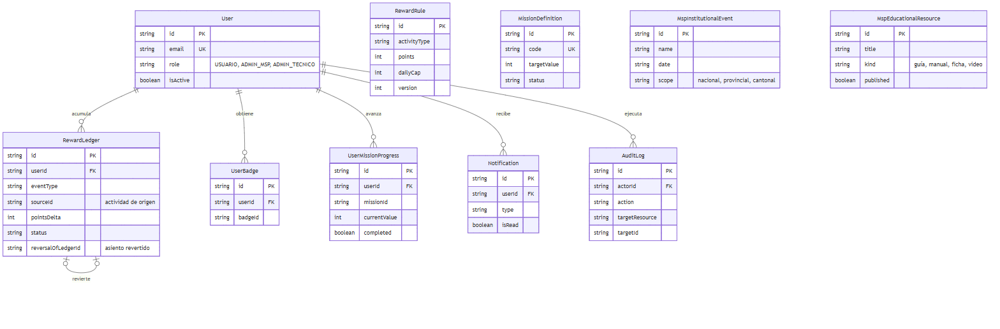

# Proyecto Versión 1 · Kawsapacha: Mi Huerto Vivo

> **Borrador del informe final** (`Proyecto-Version1-OptiCode.pdf`). Redacta: Leonardo Lugmaña. Revisa y entrega: Leonel Morales.
> Las partes marcadas como **[PENDIENTE]** esperan insumos de otros integrantes y no deben completarse con supuestos. Estructura y fuentes en el [esquema del informe](esquema-informe-v1.md).

---

## Portada

**Escuela Politécnica Nacional**
ISWD652 Calidad de Software · Período 2026B
**Proyecto:** Huertos Medicinales Comunitarios: Kawsapacha, Mi Huerto Vivo (Versión 1)
**Equipo:** OptiCode
**Fecha de entrega:** **[PENDIENTE: fecha de entrega que confirme Leonel]**

| Integrante | Rol | Usuario GitHub |
|---|---|---|
| Leonel Morales | Project Manager y desarrollo frontend | `ItsLeonel` |
| Ronny Veloz | Backend, base de datos y arquitectura | `Rodni15` |
| Dylan Maldonado | Diseño UI/UX | `DylanIMM` |
| Leonardo Lugmaña | Análisis de requisitos y documentación | `kened-leonardo` |
| Santiago Guamán | Aseguramiento de calidad y pruebas | `TonyTiago` |

Repositorio: https://github.com/ItsLeonel/OptiCode-Kawsapacha

---

## 1. Introducción

El Ministerio de Salud Pública del Ecuador (MSP) planteó, como cliente del proyecto, una aplicación web educativa que motive a las comunidades a crear y mantener huertos medicinales, usando gamificación para generar una competencia sana entre ellas. La definición del proyecto pide registrar las comunidades de siembra y sus integrantes, el huerto real de cada comunidad con su ubicación y características, la bodega, las actividades de cultivo según el calendario lunar y los saberes ancestrales, un huerto virtual que refleje el avance del huerto real y un foro moderado.

Llamamos a la aplicación *Kawsapacha* porque en kichwa significa «mundo vivo» o «naturaleza viva», y los lineamientos del MSP la presentan como la ley natural según la cual «todo es vivo y con inteligencia propia» (MSP, 2017, p. 7). La idea de fondo es que cada planta registrada en la aplicación corresponda a una planta real, con su fotografía, su ficha (que llamamos *Pasaporte Vivo*) y el historial de cuidados que recibe.

Este informe describe la primera versión: cómo analizamos los requisitos, qué historias de usuario resultaron, la arquitectura y las tecnologías del producto, el código entregado, las pruebas realizadas y las limitaciones que quedan para la siguiente versión.

---

## 2. Análisis de requisitos

### 2.1 Revisión de la definición del proyecto

Leímos la definición completa y separamos sus requisitos en dos grupos: los que forman el ciclo de un huerto real (cuentas, comunidades, huerto, catálogo, huerto virtual, actividades de cultivo, cosecha y poscosecha, recompensas y la revisión del MSP) y los que necesitan reglas que el cliente aún no ha definido, como el ranking entre comunidades, el foro o la certificación de talentos. Con esa división el Project Manager fijó el alcance de la V1 (sección 3). Al revisar la definición también aparecieron requisitos ambiguos, que registramos aparte para no resolverlos por intuición (sección 2.4).

### 2.2 Estudio de los lineamientos del MSP

El documento de referencia de la definición es *Implementación de huertos medicinales en los establecimientos de salud del primer nivel de atención. Lineamientos* (MSP, 2017). Lo revisamos buscando solo lo que afecta a la aplicación: validaciones, opciones de los formularios y contenido educativo. El resumen completo, con páginas citadas, está en [lineamientos-msp-aplicados.md](../analisis/lineamientos-msp-aplicados.md). Lo más útil para el producto fue lo siguiente.

La Tabla 1 del MSP (p. 24) define seis tipos de suelo (arcilloso, limoso, arenoso, margoso, gredoso y pantanoso), que son los mismos que pide la definición y los que ofrece el formulario del huerto. El MSP recomienda huertos de 16 a 400 m² (p. 23) y, para la región insular, solo huertos alternativos como colgantes o en macetas por la fragilidad ecológica de Galápagos (p. 20). Las fases lunares orientan cada actividad: la luna oscura sirve para preparar el suelo y deshierbar, el cuarto creciente para sembrar, la luna llena para cosechar hojas y flores, y el cuarto menguante para cosechar semillas y raíces (p. 69); el calendario lunar de la aplicación muestra estas labores citando esa fuente. El Anexo 5 clasifica las plantas en calientes y frescas: romero, manzanilla, menta, toronjil, hierbabuena y orégano son calientes, y el llantén es fresco. La señalética que imprime la aplicación usa esa clasificación y, para las especies que no figuran en el anexo, indica que la cualidad no está documentada. El secado a la sombra de 10 a 15 días (p. 51) y el etiquetado con lote y caducidad (p. 51–52) guían el registro de la poscosecha.

El MSP también deja claro que la prescripción de plantas medicinales corresponde al personal de salud (p. 56). Por eso la aplicación presenta los usos de cada planta como información educativa y no como recomendación médica, y la señalética no incluye dosis.

### 2.3 Actores

| Actor | Qué hace en el sistema |
|---|---|
| Visitante | Explora la aplicación sin cuenta; sus registros quedan solo en su navegador. |
| Participante | Pertenece a una comunidad; registra plantas, actividades y cosechas. |
| Cuidador | Integrante que además gestiona los recursos de la bodega y registra cosechas. |
| Responsable de comunidad | Crea y edita la comunidad, invita integrantes, asigna roles, registra el huerto real y archiva plantas. |
| Funcionario MSP | Revisa comunidades y actividades sin bloquearlas, y publica eventos y recursos educativos. |
| Administrador técnico | Crea las cuentas MSP, activa o desactiva usuarios y consulta la auditoría. |

Participante, Cuidador y Responsable son roles dentro de cada comunidad. Funcionario MSP y administrador técnico son roles globales de la cuenta.

### 2.4 Preguntas abiertas al cliente y decisiones

El equipo no conserva el acta ni la presentación del taller de definición del alcance, así que en este informe no se atribuye ninguna respuesta al cliente. Lo que sí hicimos fue listar las preguntas que quedaron abiertas al analizar la definición y, para cada una, la decisión provisional que tomó el equipo para poder avanzar. Algunos ejemplos: no se define con qué criterio se ordena el ranking de comunidades, ni quién certifica los talentos de un integrante, ni cuántos puntos hacen falta para pasar de Aprendiz a Oficial y a Maestro (el equipo usa 0, 100 y 300 puntos). Tampoco se define si las actividades deben aprobarse antes de otorgar puntos: el equipo decidió que la revisión del MSP no bloquee a las comunidades, de modo que cada actividad vale desde que se registra y el MSP puede invalidarla después, con reversión de sus puntos ([flujo MSP no bloqueante](../analisis/flujo-msp-v1-no-bloqueante.md)). Las trece preguntas están en [preguntas-al-cliente.md](../analisis/preguntas-al-cliente.md) y las decisiones internas en [dudas-y-decisiones-pendientes.md](../analisis/dudas-y-decisiones-pendientes.md).

### 2.5 Uso de inteligencia artificial

Para el análisis usamos Claude (Anthropic) como asistente: ayudó a resumir los lineamientos del MSP, a contrastar la definición con el código y a redactar los borradores de las historias de usuario, que luego revisó el analista frente a los documentos originales y al código. **[PENDIENTE: confirmar con cada integrante qué herramientas de IA usó y para qué.]**

---

## 3. Alcance de la Versión 1

La persona usuaria encuentra cuatro entradas en la aplicación: **Mi Huerto**, **Comunidad**, **Mi Camino Verde** y **Notificaciones**. Las cuentas institucionales tienen además los paneles MSP y técnico. Por función, la V1 se organiza en ocho módulos:

| Módulo | Contenido en la V1 |
|---|---|
| Usuarios | Registro, inicio y cierre de sesión, y modo visitante. |
| Comunidades | Creación y edición con tipo (personal, familiar, condominio, barrial), responsable, invitación de integrantes con roles, y almacén comunitario (la bodega de la definición). |
| Huertos reales | Registro y edición del huerto con provincia elegida en un mapa interactivo del Ecuador, cantón, parroquia, ubicación exacta opcional, modalidad, superficie, suelo, agua, riego, cerca y abono. |
| Catálogo y calendario | 30 especies medicinales por región con su ficha botánica y fuente, calendario de siembra y fase lunar del día. |
| Mi Huerto | Escenario 2D por región y modalidad con seis parcelas, registro de plantas con foto real, Pasaporte Vivo y Espejo Digital, que muestra la etapa observada en la planta real. |
| Ciclo agrícola y Bitácora | Preparación, siembra, riego, abonado, deshierbe, aporque, replante, seguimiento, cosecha, poscosecha, rituales de siembra y gratitud, y señalética botánica imprimible. |
| Mi Camino Verde y notificaciones | Puntos (Semillas de vida), niveles, misiones e insignias calculados en el servidor, y avisos de las revisiones del MSP. |
| Administración institucional | Revisión de comunidades y actividades, eventos y recursos educativos del MSP, cuentas institucionales y auditoría. |

Quedan para la versión 2 el ranking nacional o provincial entre comunidades con entrega de premios, el foro con moderación, la certificación de talentos, los retos definidos con el cliente, la historia visual con videos y la exportación de reportes. Detalle en [alcance-v1.md](../analisis/alcance-v1.md).

---

## 4. Historias de usuario

Redactamos 31 historias de usuario con la plantilla oficial del curso: número, título, prioridad, estimación en horas, la historia en formato «Como… quiero… para…», criterios de aceptación en formato «Dado… cuando… entonces…» con escenarios ideales y excepcionales, y las tareas de implementación con sus horas. Las estimaciones las hizo el analista y están pendientes de validar con los desarrolladores.

| Nro | Título | Prioridad | Horas |
|---|---|---|---:|
| HU-001 | Registrar una cuenta | Alta | 15 |
| HU-002 | Iniciar sesión | Alta | 11 |
| HU-003 | Cerrar sesión | Media | 5 |
| HU-004 | Explorar Kawsapacha como visitante | Media | 7 |
| HU-005 | Registrar una comunidad de siembra | Alta | 13 |
| HU-006 | Actualizar la comunidad | Alta | 7 |
| HU-007 | Invitar integrantes y gestionar sus roles | Alta | 14 |
| HU-008 | Registrar el huerto real eligiendo la provincia en el mapa | Alta | 13 |
| HU-009 | Detallar la ubicación del huerto | Media | 13 |
| HU-010 | Registrar las características del huerto | Alta | 12 |
| HU-011 | Actualizar el huerto real | Alta | 6 |
| HU-012 | Consultar el catálogo de plantas medicinales | Alta | 9 |
| HU-013 | Consultar la ficha botánica de una especie | Media | 15 |
| HU-014 | Visualizar mi huerto virtual | Alta | 24 |
| HU-015 | Registrar una planta con fotografía real | Alta | 12 |
| HU-016 | Consultar y actualizar el Pasaporte Vivo | Alta | 12 |
| HU-017 | Registrar actividades de cultivo | Media | 13 |
| HU-018 | Consultar mi progreso (Mi Camino Verde) | Media | 12 |
| HU-019 | Conservar mis registros | Alta | 11 |
| HU-020 | Responder invitaciones a una comunidad | Media | 8 |
| HU-021 | Gestionar el almacén comunitario (bodega) | Baja | 12 |
| HU-022 | Registrar la cosecha de una planta | Media | 10 |
| HU-023 | Consultar el calendario de siembra y la fase lunar | Baja | 7 |
| HU-024 | Registrar la poscosecha | Media | 12 |
| HU-025 | Registrar los rituales de siembra y de gratitud | Baja | 6 |
| HU-026 | Imprimir la señalética botánica de una planta | Media | 8 |
| HU-027 | Reflejar en el Espejo Digital la etapa real de mi planta | Alta | 14 |
| HU-028 | Consultar mis notificaciones | Media | 6 |
| HU-029 | Revisar comunidades y actividades sin bloquear a las comunidades | Alta | 16 |
| HU-030 | Publicar eventos y recursos educativos del MSP | Baja | 10 |
| HU-031 | Administrar las cuentas institucionales | Media | 12 |
| | **Total** | | **345** |

Las fichas completas están en [historias-usuario-v1.md](../historias-usuario/historias-usuario-v1.md). **[Para el Word: copiar cada HU en la tabla de la plantilla oficial.]**

---

## 5. Arquitectura y diseño técnico

### 5.1 Vista general

Kawsapacha es una aplicación web de dos partes en un solo repositorio. El frontend, hecho con React y TypeScript, se ejecuta en el navegador y dibuja el huerto virtual con el motor Phaser. El backend es una API REST en Node.js con Express que guarda los datos en una base SQLite a través de Prisma. Cuando el usuario inicia sesión, todo lo que registra viaja a la API y queda en el servidor; si entra como visitante, la aplicación funciona igual pero guarda los datos en el propio navegador con IndexedDB. Ese modo híbrido permite mostrar la aplicación sin cuenta y, al mismo tiempo, tener persistencia real para los usuarios registrados.

```text
Navegador (React 19 + Phaser)  ──HTTP/JSON──►  API REST (Express, 13 módulos)  ──Prisma──►  SQLite
        │                                                  │
        └─ modo visitante: IndexedDB                       └─ fotos: backend/uploads/
```

### 5.2 Backend: monolito modular

El backend se despliega como un solo servicio, pero por dentro está dividido en 13 módulos de negocio: `auth`, `users`, `communities`, `gardens`, `plants`, `activities`, `harvest`, `catalog`, `lunar-calendar`, `rewards`, `notifications`, `administration` y `media`. Cada módulo sigue las capas de la arquitectura limpia (*Clean Architecture*):

| Capa | Responsabilidad |
|---|---|
| `domain/` | Reglas puras del negocio, como los puntos por actividad o los límites de cuidados; no conoce Express, HTTP ni Prisma. |
| `application/` | Casos de uso y puertos (interfaces) que el caso de uso necesita. |
| `infrastructure/` | Adaptadores que implementan los puertos con Prisma, archivos y JWT. |
| `presentation/` | Controladores y rutas HTTP, con respuestas en un formato único (`{ ok, message, data }`). |

Un archivo `*.module.ts` por módulo ensambla las dependencias, y `app/router.ts` solo monta las rutas. Elegimos un monolito modular en lugar de microservicios porque el producto se despliega en un solo servidor y los módulos comparten una misma base SQLite; separar en módulos con fronteras claras nos da la mantenibilidad sin el costo de operar varios servicios ([ADR-0001](../architecture/ADR-0001-monolito-modular.md)). El CI comprueba en cada Pull Request que el dominio y la aplicación no dependan de la infraestructura y que no haya ciclos entre módulos.

### 5.3 Frontend

El frontend se organiza en tres carpetas: `app/` (navegación, sesión y coordinación entre funciones), `features/` (pantallas y operaciones de cada área: comunidades, huertos, catálogo, Mi Huerto, notificaciones y panel administrativo) y `shared/` (contratos HTTP, geografía y componentes comunes). Una función no importa a otra directamente: lo que comparten vive en `shared/`. El escenario de Phaser recibe el estado del huerto a través de un adaptador y un puente de comandos y eventos, y nunca llama a la API por su cuenta. Detalle en [la arquitectura implementada](../architecture/README.md).

### 5.4 Modelo de datos

La base tiene 21 entidades. Para que se puedan leer, las presentamos en dos diagramas: el del huerto y su ciclo agrícola, y el de recompensas, notificaciones y administración.


*Figura 1. Comunidades, huertos, plantas y ciclo agrícola (fuente: `backend/prisma/schema.prisma`; código del diagrama en [der-v1.mmd](der-v1.mmd)).*



*Figura 2. Recompensas, notificaciones y administración institucional (código del diagrama en [der-v1-institucional.mmd](der-v1-institucional.mmd)).*

| Entidad | Representa |
|---|---|
| `User` | Cuenta con correo único, contraseña cifrada, rol global (`USUARIO`, `ADMIN_MSP`, `ADMIN_TECNICO`) y estado activo. |
| `Community` | Comunidad de siembra con tipo, ubicación, foto y estado de revisión del MSP. |
| `CommunityMember` / `CommunityInvitation` | Pertenencia con rol en la comunidad, e invitaciones pendientes, aceptadas o rechazadas. |
| `RealGarden` | Huerto real con modalidad, superficie, ubicación (provincia, cantón, parroquia, coordenadas), suelo y características. |
| `MedicinalCatalog` | Especie medicinal con su ficha botánica, fuente, crédito fotográfico y datos de calendario. |
| `CultivatedPlant` | Planta en una de las seis parcelas, con foto, estado del ciclo de vida y etapa observada. |
| `GardenActivity` / `ActivityEvidence` | Cada actividad de la Bitácora, con fecha, autor, destino, estado de revisión y fotos de evidencia. |
| `CareLog` / `HarvestRecord` | Detalle de un cuidado o de una cosecha. |
| `CommunityResource` | Herramienta, insumo o semilla del almacén comunitario; las cosechas se suman aquí como recursos. |
| `RewardLedger` / `RewardRule` | Movimientos de puntos (incluidas las reversiones) y reglas de puntos por tipo de actividad. |
| `UserBadge` / `UserMissionProgress` / `MissionDefinition` | Insignias obtenidas, avance de misiones y su definición. |
| `Notification` / `AuditLog` | Avisos al usuario y registro de las acciones administrativas. |
| `MspInstitutionalEvent` / `MspEducationalResource` | Eventos y recursos educativos publicados por el MSP. |

Una restricción única sobre huerto y parcela impide que dos plantas ocupen el mismo espacio, y otra sobre usuario, tipo de evento y origen impide acreditar dos veces los puntos de una misma actividad.

### 5.5 Contratos de API

La API expone los grupos `/api/auth`, `/api/users` (con invitaciones y recompensas del usuario), `/api/communities` (con integrantes, recursos y cosechas), `/api/invitations`, `/api/gardens` (con plantas, actividades y cosechas), `/api/plants` (con Pasaporte Vivo, cuidados y cosecha), `/api/catalog`, `/api/lunar-calendar`, `/api/notifications` y `/api/admin` (paneles MSP y técnico), además de `/api/health` para comprobar el servicio. Las rutas, los cuerpos de petición y los códigos de error están en [contratos-api.md](../arquitectura/contratos-api.md).

### 5.6 Seguridad

Las contraseñas se guardan con `bcrypt` y nunca se devuelven en las respuestas. La sesión usa tokens JWT. El inicio de sesión responde siempre «Correo o contraseña incorrectos», sin decir cuál de los dos falló, para no revelar qué correos existen, y una cuenta desactivada no puede entrar. Los permisos se comprueban en el servidor en dos niveles: el rol dentro de la comunidad (solo el Responsable edita la comunidad, invita, cambia roles y archiva plantas; el Responsable y el Cuidador gestionan la bodega) y el rol global (solo `ADMIN_MSP` y `ADMIN_TECNICO` entran al panel MSP, y solo `ADMIN_TECNICO` al técnico). Cada decisión administrativa queda en la auditoría. Las fotos se limitan a JPG, PNG o WebP de hasta 3 MB, y la aplicación nunca pide la ubicación del dispositivo.

---

## 6. Diseño UI/UX

**[PENDIENTE: insumo de Dylan. Enlace al prototipo en Figma, guía visual (colores, tipografía, componentes), capturas reales del producto separadas de los mockups y decisiones de identidad regional para Costa, Sierra, Amazonía y Galápagos. Antes de redactar, actualizar el repositorio.]**

---

## 7. Herramientas y tecnologías

| Herramienta | Versión | Uso |
|---|---|---|
| React | 19.1 | Interfaz de usuario |
| TypeScript | 5.9 (frontend), 5.6 (backend) | Tipado estático en todo el proyecto |
| Vite | 7 | Servidor de desarrollo y empaquetado del frontend |
| Phaser | 3.90.0 | Escenario 2D del huerto virtual |
| Leaflet / React Leaflet | 1.9.4 / 5 | Mapa detallado para la ubicación exacta |
| Node.js | 22 LTS | Entorno de ejecución del backend |
| Express | 4.21 | API REST |
| Prisma ORM | 5.22 | Modelo de datos y migraciones |
| SQLite | (embebido) | Base de datos |
| bcryptjs / jsonwebtoken | 2.4 / 9.0 | Contraseñas y sesiones |
| Multer | 2.x | Carga de fotografías |
| Helmet / CORS | 8.0 / 2.8 | Cabeceras de seguridad y acceso entre orígenes |
| Playwright | 1.64 | Pruebas automatizadas del frontend |
| Docker / Caddy | Node 22 / Caddy 2 | Contenedores de la aplicación y servidor HTTPS |
| GitHub Actions | — | Integración continua: backend, frontend, Docker y regresión crítica |
| OpenStreetMap | — | Teselas del mapa detallado |
| Catálogo INEC DPA 2026 | — | Provincias, cantones y parroquias oficiales |
| Git y GitHub | — | Control de versiones, Issues y Pull Requests |
| Figma | — | Prototipos de interfaz |

---

## 8. Código fuente

El código está en el repositorio https://github.com/ItsLeonel/OptiCode-Kawsapacha, con el frontend en `frontend/`, el backend en `backend/`, el despliegue en `deploy/` y la documentación en `docs/`. El equipo trabajó con una rama por tarea y Pull Requests revisados antes de integrar a `main`. Cada Pull Request ejecuta cuatro flujos de integración continua: pruebas y arquitectura del backend, compilación y pruebas del frontend, construcción de Docker y regresión de los flujos críticos.

**[PENDIENTE: commit exacto de la versión entregada, que confirma Leonel. Antes de completarlo, actualizar el repositorio.]**

---

## 9. Casos de prueba y resultados

**[PENDIENTE: insumo de Santiago. Plan de pruebas, casos en la plantilla oficial con sus ejecuciones (fecha, responsable, resultado obtenido, Aprobado o Reprobado y capturas), resumen de resultados y defectos encontrados. Antes de redactar, actualizar el repositorio.]**

### 9.1 Pruebas automatizadas

Como complemento técnico, que no reemplaza los casos formales, el repositorio tiene pruebas automatizadas que se ejecutan en la integración continua. En el commit `5e024893` aprobaron 82 pruebas del backend (dominio, servicios, permisos, API y roles MSP), 82 pruebas unitarias del frontend, 32 pruebas de Playwright del huerto con Phaser y 4 pruebas de los flujos críticos (Espejo Digital, fotos, cosecha y persistencia), además de la construcción con Docker conservando la base y las fotos tras reiniciar ([regresión de arquitectura](../quality/regresion-arquitectura.md)). Estas pruebas usan una base temporal; la aceptación manual con datos reales corresponde a los casos de QA.

### 9.2 Mantenibilidad (ISO/IEC 25010)

Para la calidad interna del código tomamos como referencia las subcaracterísticas de mantenibilidad de ISO/IEC 25010:2023: modularidad, reusabilidad, analizabilidad, modificabilidad y capacidad de prueba ([criterios de calidad](../quality/README.md)). Las comprobamos con reglas automáticas en el CI:

| Subcaracterística | Evidencia |
|---|---|
| Modularidad | 13 módulos backend sin ciclos entre ellos; 0 importaciones directas entre funciones del frontend. |
| Analizabilidad | Cada módulo separa dominio, aplicación, infraestructura y presentación; las decisiones se registran en ADR. |
| Modificabilidad | La capa de aplicación no depende de Prisma; el escenario de Phaser no depende del cliente HTTP. |
| Capacidad de prueba | Los casos de uso se prueban con repositorios simulados, sin base de datos. |
| Reusabilidad | Contratos, geografía, iconos y catálogo compartidos en `frontend/src/shared/`. |

Estas métricas son estructurales: no demuestran por sí solas la ausencia de defectos funcionales.

---

## 10. Producto operativo

Para ejecutar la aplicación se encienden dos servicios. Primero el backend: en la carpeta `backend` se copia `.env.example` a `.env`, se instalan las dependencias, se crea la base con `npx prisma migrate deploy`, se cargan las 30 especies y las cuentas técnicas con `npm run prisma:seed` y se inicia con `npm run dev`; la dirección `http://localhost:3000/api/health` confirma que funciona. Después el frontend: en la carpeta `frontend` se instalan las dependencias y se ejecuta `npm run dev`, y la aplicación queda disponible en `http://localhost:5173`. El repositorio también incluye la configuración de Docker y Caddy para levantar la aplicación con HTTPS. Las instrucciones completas están en el [README](../../README.md).

Para las pruebas, el seed crea dos administradores técnicos (`admin1@mail.com` y `admin2@mail.com`); desde su panel se crean las cuentas MSP, y las cuentas comunitarias se crean desde la pantalla de bienvenida ([credenciales](../CREDENCIALES-Y-ACTUALIZACION-BD.md)). Las contraseñas de ejemplo son solo para desarrollo.

El recorrido de la demostración es: crear cuenta, iniciar sesión, crear una comunidad, registrar el huerto eligiendo la provincia en el mapa, elegir una especie, subir una foto real, colocar la planta en una parcela, registrar un riego y un seguimiento en la Bitácora, abrir su Pasaporte Vivo y Mi Camino Verde, revisar la actividad desde el panel MSP y comprobar que los datos siguen ahí después de cerrar e iniciar sesión.

**[PENDIENTE: capturas del recorrido sobre el commit entregado.]**

---

## 11. Limitaciones y trabajo futuro

La V1 cubre el ciclo completo del huerto, pero hay puntos incompletos que conviene decir con claridad:

- **Ficha botánica:** las 30 fichas tienen familia, altitud, provincias, ciclo, usos y fuente, pero la cualidad caliente o fresca figura como «por documentar» (la señalética sí la toma del MSP para siete especies) y solo 13 especies tienen fotografía.
- **Datos personales de integrantes:** la fecha de nacimiento, el género y los talentos no se guardan en el servidor.
- **Orientaciones del MSP sin aplicar:** la aplicación no sugiere modalidades sin suelo para Galápagos ni avisa cuando la superficie sale del rango de 16 a 400 m².
- **Atomicidad:** algunas operaciones que encadenan varios registros (actividad, evidencia, puntos y misiones; cosecha e inventario) no se ejecutan en una sola transacción, por lo que una falla intermedia puede dejar un estado parcial ([ADR-0002](../architecture/ADR-0002-limites-transaccionales.md)).
- **Fotografías:** antes de abrir la plataforma al público hay que restringir el acceso directo a `/uploads`, donde están las fotos de las comunidades.
- **Modo visitante:** los datos dependen del navegador y se pierden si se borran los datos del sitio.

Para la versión 2 quedan el ranking entre comunidades con entrega de premios, el foro con moderación, la certificación de talentos, los retos definidos con el cliente, la historia visual con videos y la exportación de reportes. Las decisiones pendientes del equipo están en [dudas-y-decisiones-pendientes.md](../analisis/dudas-y-decisiones-pendientes.md).

---

## 12. Conclusiones

**[PENDIENTE: redactar al final, con los resultados reales de las pruebas.]**

---

## 13. Referencias

- Escuela Politécnica Nacional. (2026). *Definición del proyecto «Huertos Medicinales Comunitarios»*. ISWD652 Calidad de Software, período 2026B.
- Ministerio de Salud Pública del Ecuador. (2017). *Implementación de huertos medicinales en los establecimientos de salud del primer nivel de atención. Lineamientos* (1.ª ed.). Dirección Nacional de Salud Intercultural.
- International Organization for Standardization. (2023). *ISO/IEC 25010:2023 Systems and software engineering — Systems and software Quality Requirements and Evaluation (SQuaRE) — Product quality model*.
- Instituto Nacional de Estadística y Censos. (2026). *División Político Administrativa (DPA)*.
- OpenStreetMap contributors. *OpenStreetMap*. https://www.openstreetmap.org/copyright
- Documentación oficial de React, Vite, Phaser, Express, Prisma, Playwright y Docker.

---

## Anexos

- Repositorio: https://github.com/ItsLeonel/OptiCode-Kawsapacha
- README e instrucciones de ejecución: [README.md](../../README.md)
- Historias de usuario: [historias-usuario-v1.md](../historias-usuario/historias-usuario-v1.md)
- Arquitectura y contratos: [arquitectura implementada](../architecture/README.md), [contratos-api.md](../arquitectura/contratos-api.md)
- Calidad: [mantenibilidad y regresión](../quality/README.md)
- Casos de prueba y evidencias: [docs/casos-prueba/](../casos-prueba/) **[PENDIENTE]**
- Diseño: [docs/diseno/](../diseno/) **[PENDIENTE]**
