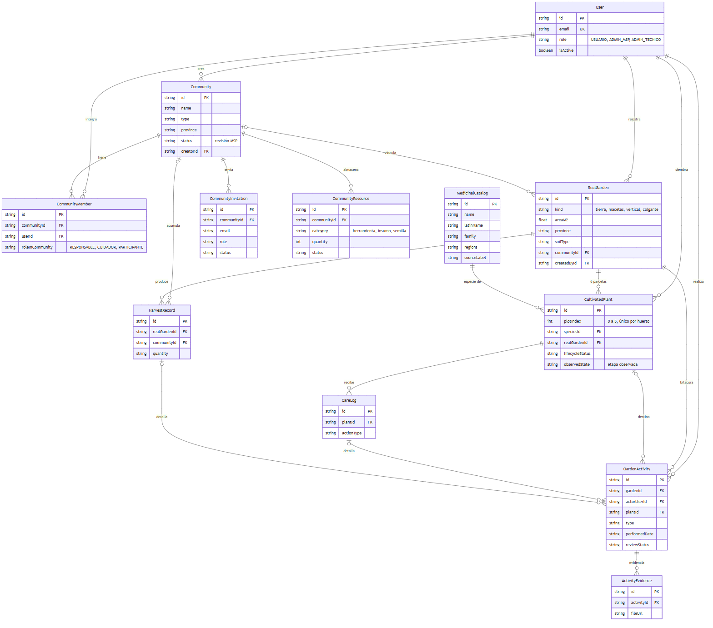
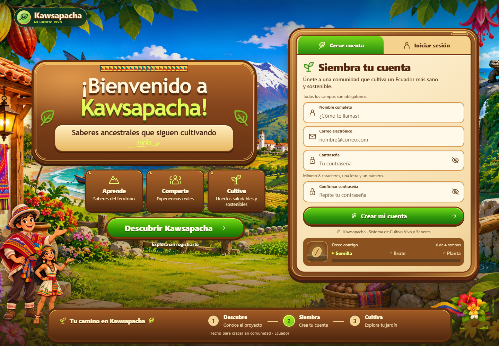

# Proyecto Versión 1 · Kawsapacha: Mi Huerto Vivo

> **Informe final en Markdown.** La versión que se entrega es el Word [Proyecto-Version1-OptiCode.docx](Proyecto-Version1-OptiCode.docx). Redacta: Leonardo Lugmaña. Revisa y entrega: Leonel Morales.
> Estructura y fuentes en el [esquema del informe](esquema-informe-v1.md).

---

## Portada

**Escuela Politécnica Nacional**
ISWD652 Calidad de Software · Período 2026B
**Proyecto:** Huertos Medicinales Comunitarios: Kawsapacha, Mi Huerto Vivo (Versión 1)
**Equipo:** OptiCode
**Fecha de entrega:** 16 de noviembre de 2026

| Integrante | Rol | Usuario GitHub |
|---|---|---|
| Leonel Morales | Project Manager y desarrollo frontend | `ItsLeonel` |
| Ronny Veloz | Backend, base de datos y arquitectura | `Rodni15` |
| Dylan Maldonado | Diseño UI/UX | `DylanIMM` |
| Leonardo Lugmaña | Análisis de requisitos y documentación | `kened-leonardo` |
| Santiago Guamán | Aseguramiento de calidad y pruebas | `TonyTiago` |

Repositorio: https://github.com/ItsLeonel/OptiCode-Kawsapacha

---

## 1. Introducción

El Ministerio de Salud Pública del Ecuador (MSP) planteó, como cliente del proyecto, una aplicación web educativa que motive a las comunidades a crear y mantener huertos medicinales, usando gamificación para generar una competencia sana entre ellas. La definición del proyecto pide registrar las comunidades de siembra y sus integrantes, el huerto real de cada comunidad con su ubicación y características, la bodega, las actividades de cultivo según el calendario lunar y los saberes ancestrales, un huerto virtual que refleje el avance del huerto real y un foro moderado.

Llamamos a la aplicación *Kawsapacha* porque en kichwa significa «mundo vivo» o «naturaleza viva», y los lineamientos del MSP la presentan como la ley natural según la cual «todo es vivo y con inteligencia propia» (MSP, 2017, p. 7). La idea de fondo es que cada planta registrada en la aplicación corresponda a una planta real, con su fotografía, su ficha (que llamamos *Pasaporte Vivo*) y el historial de cuidados que recibe.

Este informe describe la primera versión: cómo analizamos los requisitos, qué historias de usuario resultaron, la arquitectura y las tecnologías del producto, el código entregado, las pruebas realizadas y las limitaciones que quedan para la siguiente versión.

---

## 2. Análisis de requisitos

### 2.1 Revisión de la definición del proyecto

Leímos la definición completa y separamos sus requisitos en dos grupos: los que forman el ciclo de un huerto real (cuentas, comunidades, huerto, catálogo, huerto virtual, actividades de cultivo, cosecha y poscosecha, recompensas y la revisión del MSP) y los que necesitan reglas que el cliente aún no ha definido, como el ranking entre comunidades, el foro o la certificación de talentos. Con esa división el Project Manager fijó el alcance de la V1 (sección 3). Al revisar la definición también aparecieron requisitos ambiguos, que registramos aparte para no resolverlos por intuición (sección 2.4).

### 2.2 Estudio de los lineamientos del MSP

El documento de referencia de la definición es *Implementación de huertos medicinales en los establecimientos de salud del primer nivel de atención. Lineamientos* (MSP, 2017). Lo revisamos buscando solo lo que afecta a la aplicación: validaciones, opciones de los formularios y contenido educativo. El resumen completo, con páginas citadas, está en [lineamientos-msp-aplicados.md](../analisis/lineamientos-msp-aplicados.md). Lo más útil para el producto fue lo siguiente.

La Tabla 1 del MSP (p. 24) define seis tipos de suelo (arcilloso, limoso, arenoso, margoso, gredoso y pantanoso), que son los mismos que pide la definición y los que ofrece el formulario del huerto. El MSP recomienda huertos de 16 a 400 m² (p. 23) y, para la región insular, solo huertos alternativos como colgantes o en macetas por la fragilidad ecológica de Galápagos (p. 20). Las fases lunares orientan cada actividad: la luna oscura sirve para preparar el suelo y deshierbar, el cuarto creciente para sembrar, la luna llena para cosechar hojas y flores, y el cuarto menguante para cosechar semillas y raíces (p. 69); el calendario lunar de la aplicación muestra estas labores citando esa fuente. El Anexo 5 clasifica las plantas en calientes y frescas: romero, manzanilla, menta, toronjil, hierbabuena y orégano son calientes, y el llantén es fresco. La señalética que imprime la aplicación usa esa clasificación y, para las especies que no figuran en el anexo, indica que la cualidad no está documentada. El secado a la sombra de 10 a 15 días (p. 51) y el etiquetado con lote y caducidad (p. 51–52) guían el registro de la poscosecha.

El MSP también deja claro que la prescripción de plantas medicinales corresponde al personal de salud (p. 56). Por eso la aplicación presenta los usos de cada planta como información educativa y no como recomendación médica, y la señalética no incluye dosis.

### 2.3 Actores

| Actor | Qué hace en el sistema |
|---|---|
| Visitante | Explora la aplicación sin cuenta; sus registros quedan solo en su navegador. |
| Participante | Pertenece a una comunidad; registra plantas, actividades y cosechas. |
| Cuidador | Integrante que además gestiona los recursos de la bodega y registra cosechas. |
| Responsable de comunidad | Crea y edita la comunidad, invita integrantes, asigna roles, registra el huerto real y archiva plantas. |
| Funcionario MSP | Revisa comunidades y actividades sin bloquearlas, y publica eventos y recursos educativos. |
| Administrador técnico | Crea las cuentas MSP, activa o desactiva usuarios y consulta la auditoría. |

Participante, Cuidador y Responsable son roles dentro de cada comunidad. Funcionario MSP y administrador técnico son roles globales de la cuenta.

### 2.4 Preguntas abiertas al cliente y decisiones

El equipo no conserva el acta ni la presentación del taller de definición del alcance, así que en este informe no se atribuye ninguna respuesta al cliente. Lo que sí hicimos fue listar las preguntas que quedaron abiertas al analizar la definición y, para cada una, la decisión provisional que tomó el equipo para poder avanzar. Algunos ejemplos: no se define con qué criterio se ordena el ranking de comunidades, ni quién certifica los talentos de un integrante, ni cuántos puntos hacen falta para pasar de Aprendiz a Oficial y a Maestro (el equipo usa 0, 100 y 300 puntos). Tampoco se define si las actividades deben aprobarse antes de otorgar puntos: el equipo decidió que la revisión del MSP no bloquee a las comunidades, de modo que cada actividad vale desde que se registra y el MSP puede invalidarla después, con reversión de sus puntos ([flujo MSP no bloqueante](../analisis/flujo-msp-v1-no-bloqueante.md)). Las trece preguntas están en [preguntas-al-cliente.md](../analisis/preguntas-al-cliente.md) y las decisiones internas en [dudas-y-decisiones-pendientes.md](../analisis/dudas-y-decisiones-pendientes.md).

---

## 3. Alcance de la Versión 1

La persona usuaria encuentra cuatro entradas en la aplicación: **Mi Huerto**, **Comunidad**, **Mi Camino Verde** y **Notificaciones**. Las cuentas institucionales tienen además los paneles MSP y técnico. Por función, la V1 se organiza en ocho módulos:

| Módulo | Contenido en la V1 |
|---|---|
| Usuarios | Registro, inicio y cierre de sesión, y modo visitante. |
| Comunidades | Creación y edición con tipo (personal, familiar, condominio, barrial), responsable, invitación de integrantes con roles, y almacén comunitario (la bodega de la definición). |
| Huertos reales | Registro y edición del huerto con provincia elegida en un mapa interactivo del Ecuador, cantón, parroquia, ubicación exacta opcional, modalidad, superficie, suelo, agua, riego, cerca y abono. |
| Catálogo y calendario | 30 especies medicinales por región con su ficha botánica y fuente, calendario de siembra y fase lunar del día. |
| Mi Huerto | Escenario 2D por región y modalidad con seis parcelas, registro de plantas con foto real, Pasaporte Vivo y Espejo Digital, que muestra la etapa observada en la planta real. |
| Ciclo agrícola y Bitácora | Preparación, siembra, riego, abonado, deshierbe, aporque, replante, seguimiento, cosecha, poscosecha, rituales de siembra y gratitud, y señalética botánica imprimible. |
| Mi Camino Verde y notificaciones | Puntos (Semillas de vida), niveles, misiones e insignias calculados en el servidor, y avisos de las revisiones del MSP. |
| Administración institucional | Revisión de comunidades y actividades, eventos y recursos educativos del MSP, cuentas institucionales y auditoría. |

Quedan para la versión 2 el ranking nacional o provincial entre comunidades con entrega de premios, el foro con moderación, la certificación de talentos, los retos definidos con el cliente, la historia visual con videos y la exportación de reportes. Detalle en [alcance-v1.md](../analisis/alcance-v1.md).

---

## 4. Historias de usuario

Redactamos 31 historias de usuario con la plantilla oficial del curso: número, título, prioridad, estimación en horas, la historia en formato «Como… quiero… para…», criterios de aceptación en formato «Dado… cuando… entonces…» con escenarios ideales y excepcionales, y las tareas de implementación con sus horas. Las estimaciones las hizo el analista y están pendientes de validar con los desarrolladores.

| Nro | Título | Prioridad | Horas |
|---|---|---|---:|
| HU-001 | Registrar una cuenta | Alta | 15 |
| HU-002 | Iniciar sesión | Alta | 11 |
| HU-003 | Cerrar sesión | Media | 5 |
| HU-004 | Explorar Kawsapacha como visitante | Media | 7 |
| HU-005 | Registrar una comunidad de siembra | Alta | 13 |
| HU-006 | Actualizar la comunidad | Alta | 7 |
| HU-007 | Invitar integrantes y gestionar sus roles | Alta | 14 |
| HU-008 | Registrar el huerto real eligiendo la provincia en el mapa | Alta | 13 |
| HU-009 | Detallar la ubicación del huerto | Media | 13 |
| HU-010 | Registrar las características del huerto | Alta | 12 |
| HU-011 | Actualizar el huerto real | Alta | 6 |
| HU-012 | Consultar el catálogo de plantas medicinales | Alta | 9 |
| HU-013 | Consultar la ficha botánica de una especie | Media | 15 |
| HU-014 | Visualizar mi huerto virtual | Alta | 24 |
| HU-015 | Registrar una planta con fotografía real | Alta | 12 |
| HU-016 | Consultar y actualizar el Pasaporte Vivo | Alta | 12 |
| HU-017 | Registrar actividades de cultivo | Media | 13 |
| HU-018 | Consultar mi progreso (Mi Camino Verde) | Media | 12 |
| HU-019 | Conservar mis registros | Alta | 11 |
| HU-020 | Responder invitaciones a una comunidad | Media | 8 |
| HU-021 | Gestionar el almacén comunitario (bodega) | Baja | 12 |
| HU-022 | Registrar la cosecha de una planta | Media | 10 |
| HU-023 | Consultar el calendario de siembra y la fase lunar | Baja | 7 |
| HU-024 | Registrar la poscosecha | Media | 12 |
| HU-025 | Registrar los rituales de siembra y de gratitud | Baja | 6 |
| HU-026 | Imprimir la señalética botánica de una planta | Media | 8 |
| HU-027 | Reflejar en el Espejo Digital la etapa real de mi planta | Alta | 14 |
| HU-028 | Consultar mis notificaciones | Media | 6 |
| HU-029 | Revisar comunidades y actividades sin bloquear a las comunidades | Alta | 16 |
| HU-030 | Publicar eventos y recursos educativos del MSP | Baja | 10 |
| HU-031 | Administrar las cuentas institucionales | Media | 12 |
| | **Total** | | **345** |

Las fichas completas están en [historias-usuario-v1.md](../historias-usuario/historias-usuario-v1.md). **[Para el Word: copiar cada HU en la tabla de la plantilla oficial.]**

---

## 5. Arquitectura y diseño técnico

### 5.1 Vista general

Kawsapacha es una aplicación web de dos partes en un solo repositorio. El frontend, hecho con React y TypeScript, se ejecuta en el navegador y dibuja el huerto virtual con el motor Phaser. El backend es una API REST en Node.js con Express que guarda los datos en una base SQLite a través de Prisma. Cuando el usuario inicia sesión, todo lo que registra viaja a la API y queda en el servidor; si entra como visitante, la aplicación funciona igual pero guarda los datos en el propio navegador con IndexedDB. Ese modo híbrido permite mostrar la aplicación sin cuenta y, al mismo tiempo, tener persistencia real para los usuarios registrados.

```text
Navegador (React 19 + Phaser)  ──HTTP/JSON──►  API REST (Express, 13 módulos)  ──Prisma──►  SQLite
        │                                                  │
        └─ modo visitante: IndexedDB                       └─ fotos: backend/uploads/
```

### 5.2 Backend: monolito modular

El backend se despliega como un solo servicio, pero por dentro está dividido en 13 módulos de negocio: `auth`, `users`, `communities`, `gardens`, `plants`, `activities`, `harvest`, `catalog`, `lunar-calendar`, `rewards`, `notifications`, `administration` y `media`. Cada módulo sigue las capas de la arquitectura limpia (*Clean Architecture*):

| Capa | Responsabilidad |
|---|---|
| `domain/` | Reglas puras del negocio, como los puntos por actividad o los límites de cuidados; no conoce Express, HTTP ni Prisma. |
| `application/` | Casos de uso y puertos (interfaces) que el caso de uso necesita. |
| `infrastructure/` | Adaptadores que implementan los puertos con Prisma, archivos y JWT. |
| `presentation/` | Controladores y rutas HTTP, con respuestas en un formato único (`{ ok, message, data }`). |

Un archivo `*.module.ts` por módulo ensambla las dependencias, y `app/router.ts` solo monta las rutas. Elegimos un monolito modular en lugar de microservicios porque el producto se despliega en un solo servidor y los módulos comparten una misma base SQLite; separar en módulos con fronteras claras nos da la mantenibilidad sin el costo de operar varios servicios ([ADR-0001](../architecture/ADR-0001-monolito-modular.md)). El CI comprueba en cada Pull Request que el dominio y la aplicación no dependan de la infraestructura y que no haya ciclos entre módulos.

### 5.3 Frontend

El frontend se organiza en tres carpetas: `app/` (navegación, sesión y coordinación entre funciones), `features/` (pantallas y operaciones de cada área: comunidades, huertos, catálogo, Mi Huerto, notificaciones y panel administrativo) y `shared/` (contratos HTTP, geografía y componentes comunes). Una función no importa a otra directamente: lo que comparten vive en `shared/`. El escenario de Phaser recibe el estado del huerto a través de un adaptador y un puente de comandos y eventos, y nunca llama a la API por su cuenta. Detalle en [la arquitectura implementada](../architecture/README.md).

### 5.4 Modelo de datos

La base tiene 21 entidades. Para que se puedan leer, las presentamos en dos diagramas: el del huerto y su ciclo agrícola, y el de recompensas, notificaciones y administración.



*Figura 1. Comunidades, huertos, plantas y ciclo agrícola (fuente: `backend/prisma/schema.prisma`; código del diagrama en [der-v1.mmd](der-v1.mmd)).*


*Figura 2. Recompensas, notificaciones y administración institucional (código del diagrama en [der-v1-institucional.mmd](der-v1-institucional.mmd)).*

| Entidad | Representa |
|---|---|
| `User` | Cuenta con correo único, contraseña cifrada, rol global (`USUARIO`, `ADMIN_MSP`, `ADMIN_TECNICO`) y estado activo. |
| `Community` | Comunidad de siembra con tipo, ubicación, foto y estado de revisión del MSP. |
| `CommunityMember` / `CommunityInvitation` | Pertenencia con rol en la comunidad, e invitaciones pendientes, aceptadas o rechazadas. |
| `RealGarden` | Huerto real con modalidad, superficie, ubicación (provincia, cantón, parroquia, coordenadas), suelo y características. |
| `MedicinalCatalog` | Especie medicinal con su ficha botánica, fuente, crédito fotográfico y datos de calendario. |
| `CultivatedPlant` | Planta en una de las seis parcelas, con foto, estado del ciclo de vida y etapa observada. |
| `GardenActivity` / `ActivityEvidence` | Cada actividad de la Bitácora, con fecha, autor, destino, estado de revisión y fotos de evidencia. |
| `CareLog` / `HarvestRecord` | Detalle de un cuidado o de una cosecha. |
| `CommunityResource` | Herramienta, insumo o semilla del almacén comunitario; las cosechas se suman aquí como recursos. |
| `RewardLedger` / `RewardRule` | Movimientos de puntos (incluidas las reversiones) y reglas de puntos por tipo de actividad. |
| `UserBadge` / `UserMissionProgress` / `MissionDefinition` | Insignias obtenidas, avance de misiones y su definición. |
| `Notification` / `AuditLog` | Avisos al usuario y registro de las acciones administrativas. |
| `MspInstitutionalEvent` / `MspEducationalResource` | Eventos y recursos educativos publicados por el MSP. |

Una restricción única sobre huerto y parcela impide que dos plantas ocupen el mismo espacio, y otra sobre usuario, tipo de evento y origen impide acreditar dos veces los puntos de una misma actividad.

### 5.5 Contratos de API

La API expone los grupos `/api/auth`, `/api/users` (con invitaciones y recompensas del usuario), `/api/communities` (con integrantes, recursos y cosechas), `/api/invitations`, `/api/gardens` (con plantas, actividades y cosechas), `/api/plants` (con Pasaporte Vivo, cuidados y cosecha), `/api/catalog`, `/api/lunar-calendar`, `/api/notifications` y `/api/admin` (paneles MSP y técnico), además de `/api/health` para comprobar el servicio. Las rutas, los cuerpos de petición y los códigos de error están en [contratos-api.md](../arquitectura/contratos-api.md).

### 5.6 Seguridad

Las contraseñas se guardan con `bcrypt` y nunca se devuelven en las respuestas. La sesión usa tokens JWT. El inicio de sesión responde siempre «Correo o contraseña incorrectos», sin decir cuál de los dos falló, para no revelar qué correos existen, y una cuenta desactivada no puede entrar. Los permisos se comprueban en el servidor en dos niveles: el rol dentro de la comunidad (solo el Responsable edita la comunidad, invita, cambia roles y archiva plantas; el Responsable y el Cuidador gestionan la bodega) y el rol global (solo `ADMIN_MSP` y `ADMIN_TECNICO` entran al panel MSP, y solo `ADMIN_TECNICO` al técnico). Cada decisión administrativa queda en la auditoría. Las fotos se limitan a JPG, PNG o WebP de hasta 3 MB, y la aplicación nunca pide la ubicación del dispositivo.

---

## 6. Diseño UI/UX

### 6.1 Identidad visual

Kawsapacha combina una interfaz de cultivo educativo con referencias visuales del Ecuador: paisajes regionales, vegetación, madera, tierra, tejidos ilustrados y un personaje guía por región. La aplicación trabaja con dos registros visuales: la **interfaz de producto** (formularios, comunidad, catálogo), con superficies claras y acentos verdes, y la **capa de juego** de Mi Huerto, con paneles cálidos de madera sobre el escenario ilustrado. La guía visual completa, con los valores tomados del código, está en [guia-visual-v1.md](../diseno/guia-visual-v1.md).

| Elemento | Valores principales |
|---|---|
| Colores base | Verde oscuro `#173e34` (texto) y `#14392f` (navegación), fondo neutro `#f6f5f0`, foco visible dorado `#d3a263`. |
| Capa de juego | Madera `#48200f`, `#8e4c21` y `#c68037`; acentos lima `#90d523` y dorado `#ffe685`. |
| Color por región | Sierra `#9c61cb`, Costa `#f4bb31`, Amazonía `#75c943` y Galápagos `#3abbe8`, aplicados en la interfaz de juego según la región del huerto. |
| Tipografía | DM Sans para el texto general y Outfit para los títulos; Trebuchet MS en la capa de juego. |
| Iconografía | Iconos SVG propios (hoja, huerto, comunidad, semilla, maceta, cámara) e ilustraciones de paisajes y personajes guía por región. |

### 6.2 Decisiones de diseño

- **React para la interfaz, Phaser para el escenario.** React arma formularios, paneles, diálogos y el HUD; Phaser solo dibuja el paisaje y las seis parcelas. Así los controles siguen siendo accesibles aunque el escenario sea un lienzo gráfico.
- **La provincia define la región visual.** Al elegir la provincia del huerto, la aplicación asigna el paisaje y el personaje guía de Costa, Sierra, Amazonía o Galápagos.
- **Seis parcelas en todas las modalidades.** En tierra, macetas, vertical y colgante usan el mismo modelo de seis espacios, con identificadores estables.
- **Visitante y sesión se distinguen.** La interfaz indica cuándo los datos se guardan solo en el navegador y cuándo en el servidor.
- **Accesibilidad básica.** Hay foco visible en todos los controles, nombres accesibles, mensajes con `role="status"` y una lista de botones para operar las parcelas con teclado sin depender del lienzo.

La propuesta visual de Dylan está en Figma: [diseño propuesto Kawsapacha](https://www.figma.com/design/w5Ky7101rMa2XW6cWX5nYi/dise%C3%B1o-propuesto-kawsapacha?node-id=0-1&t=qNBA6nsNjoBFpH1m-1). Es una referencia de diseño, no un prototipo idéntico a la aplicación.

### 6.3 Capturas del producto

Las siguientes capturas son de la aplicación en ejecución local, tomadas por Dylan el 09/11/2026 en un navegador de escritorio (1440 × 1000). El conjunto completo, con las versiones móviles, está en [entrega-ui-ux-v1.md](../diseno/entrega-ui-ux-v1.md).



*Figura 3. Bienvenida con las pestañas de registro e inicio de sesión.*


*Figura 4. Mi Huerto en la región Costa, con el HUD, la guía regional y las seis parcelas.*


*Figura 5. Pasaporte Vivo de una planta registrada.*

### 6.4 Hallazgos de experiencia de usuario

La revisión de Dylan clasificó los hallazgos por severidad. Ninguno impide el recorrido principal: la aplicación carga, el visitante llega a Mi Huerto, se crean la comunidad y el terreno y se registra una planta.

| Id | Severidad | Hallazgo | Corrección propuesta |
|---|---|---|---|
| P0-001 | Alta | En Comunidad, en modo visitante, conviven los mensajes «Datos guardados en la base de datos» y «Guardado local · Solo en este navegador». | Mostrar un solo mensaje según el modo de uso. |
| UX-001 | Media | En el teléfono (390 px), el aviso de guardado se superpone unos 18 px con las acciones rápidas de Mi Huerto. | Reubicar el aviso en una franja libre. |
| UX-002 | Media | En el teléfono, las seis parcelas caben en pantalla, pero cada una mide unos 28 × 17 px y las laterales se distinguen poco. | Agrandar las parcelas u ofrecer un selector de parcela. |
| UX-004 | Media | En el teléfono, el tercio inferior de Mi Huerto concentra demasiados controles y las etiquetas bajan a 10 px. | Colapsar la guía regional y subir el tamaño de las etiquetas. |
| UX-005 | Media | En Mi terreno, en el teléfono, el formulario empieza muy abajo por el peso de la cabecera y la navegación. | Reducir la cabecera en pantallas pequeñas. |

El detalle, con mediciones y archivos relacionados, está en [entrega-ui-ux-v1.md](../diseno/entrega-ui-ux-v1.md). La revisión se hizo en escritorio (1440 × 1000) y en un ancho de teléfono simulado (390 × 844); no incluye dispositivos reales ni las regiones Sierra, Amazonía y Galápagos.

---

## 7. Herramientas y tecnologías

| Herramienta | Versión | Uso |
|---|---|---|
| React | 19.1 | Interfaz de usuario |
| TypeScript | 5.9 (frontend), 5.6 (backend) | Tipado estático en todo el proyecto |
| Vite | 7 | Servidor de desarrollo y empaquetado del frontend |
| Phaser | 3.90.0 | Escenario 2D del huerto virtual |
| Leaflet / React Leaflet | 1.9.4 / 5 | Mapa detallado para la ubicación exacta |
| Node.js | 22 LTS | Entorno de ejecución del backend |
| Express | 4.21 | API REST |
| Prisma ORM | 5.22 | Modelo de datos y migraciones |
| SQLite | (embebido) | Base de datos |
| bcryptjs / jsonwebtoken | 2.4 / 9.0 | Contraseñas y sesiones |
| Multer | 2.x | Carga de fotografías |
| Helmet / CORS | 8.0 / 2.8 | Cabeceras de seguridad y acceso entre orígenes |
| Playwright | 1.64 | Pruebas automatizadas del frontend |
| Docker / Caddy | Node 22 / Caddy 2 | Contenedores de la aplicación y servidor HTTPS |
| GitHub Actions | — | Integración continua: backend, frontend, Docker y regresión crítica |
| OpenStreetMap | — | Teselas del mapa detallado |
| Catálogo INEC DPA 2026 | — | Provincias, cantones y parroquias oficiales |
| Git y GitHub | — | Control de versiones, Issues y Pull Requests |
| Figma | — | Prototipos de interfaz |

---

## 8. Código fuente

El código está en el repositorio https://github.com/ItsLeonel/OptiCode-Kawsapacha, con el frontend en `frontend/`, el backend en `backend/`, el despliegue en `deploy/` y la documentación en `docs/`. El equipo trabajó con una rama por tarea y Pull Requests revisados antes de integrar a `main`. Cada Pull Request ejecuta cuatro flujos de integración continua: pruebas y arquitectura del backend, compilación y pruebas del frontend, construcción de Docker y regresión de los flujos críticos.

La versión entregada es la rama `main` del repositorio.

---

## 9. Casos de prueba y resultados

### 9.1 Plan de pruebas

Santiago Guamán diseñó los casos de prueba con la plantilla oficial del curso y los ejecutó manualmente ([plan-pruebas-v1.md](../casos-prueba/plan-pruebas-v1.md)). Después, los casos críticos se volvieron a ejecutar sobre la versión entregada y se añadieron cuatro casos para las historias que no tenían cobertura ([casos-prueba-v2.md](../casos-prueba/casos-prueba-v2.md)). La estrategia cubrió pruebas funcionales, validaciones de formularios, persistencia de datos, accesibilidad básica (teclado y pantalla de 375 px) e integración con el backend: cuentas reales, aislamiento de datos entre dos cuentas y el recorrido completo de la demostración. Los datos de prueba fueron ficticios (correos `@example.com` y nombres como «Tester QA»).

| Elemento | Primera ejecución | Ejecución sobre la versión entregada |
|---|---|---|
| Fecha | 08/11/2026 | 15/11/2026 |
| Responsable | Santiago Guamán | Leonardo Lugmaña |
| Versión | `8066d69` (P-001 a P-009) y `de1c6c9` (P-010 a P-017) | `main` en `661ad6b` |
| Casos | P-001 a P-017 | P-001, P-010 a P-013 y los nuevos P-018 a P-021 |
| Forma | Manual, en Mozilla Firefox | Automatizada con Playwright (interfaz) y llamadas a la API, sobre una base de datos temporal creada desde cero |
| Criterio | Aprobado si lo obtenido coincide con lo esperado, con captura; Reprobado si difiere, con registro de la incidencia y reejecución | El mismo |

### 9.2 Resultados

Se diseñaron y ejecutaron **17 casos**. Los 17 terminaron **aprobados**. Cinco fallaron en la primera ejecución y se aprobaron al reejecutarlos después de corregir la causa.

| Caso | Título | HU | 1.ª ejecución | Estado final |
|---|---|---|---|---|
| P-001 | Bienvenida y exploración en modo visitante | HU-004 | Aprobado | Aprobado |
| P-002 | Validación de formularios de registro e inicio de sesión | HU-001, HU-002 | Aprobado | Aprobado |
| P-003 | Crear comunidad: validaciones y creación correcta | HU-005, HU-007 | Aprobado | Aprobado |
| P-004 | Editar comunidad, integrantes y conservación tras recarga | HU-006 | Aprobado | Aprobado |
| P-005 | Selección de provincia, cantón y parroquia coherentes | HU-008, HU-009 | Aprobado | Aprobado |
| P-006 | Registrar huerto real con todos sus datos | HU-010 | Aprobado | Aprobado |
| P-007 | Editar huerto y cancelar la edición | HU-011 | Aprobado | Aprobado |
| P-008 | Persistencia local al recargar | HU-019 | Aprobado | Aprobado |
| P-009 | Uso con teclado y pantalla móvil básica | Transversal | Aprobado | Aprobado |
| P-010 | Crear cuenta e iniciar/cerrar sesión con backend real | HU-001, HU-002, HU-003 | Reprobado | Aprobado |
| P-011 | Aislamiento de datos entre dos cuentas | HU-002, HU-006, HU-007 | Reprobado | Aprobado |
| P-012 | Persistencia en base de datos de comunidad y huerto | HU-019 | Reprobado | Aprobado |
| P-013 | Flujo integrado de demostración | HU-003, HU-019 | Reprobado | Aprobado |
| P-014 | Mi Huerto: catálogo, registro de planta y Pasaporte Vivo | HU-014 a HU-017 | Aprobado | Aprobado |
| P-015 | Integración final de Mi Huerto | HU-014 | Aprobado | Aprobado |
| P-016 | Puntos y niveles (exploratorio) | HU-018 | Aprobado | Aprobado |
| P-017 | Catálogo de plantas medicinales: búsqueda y ficha | HU-012, HU-013 | Reprobado | Aprobado |

En la ejecución del 15/11/2026 sobre la versión entregada se aprobaron los **9 casos** ejecutados:

| Caso | Título | HU | Resultado |
|---|---|---|---|
| P-001 | Bienvenida y exploración en modo visitante | HU-004 | Aprobado |
| P-010 | Crear cuenta e iniciar/cerrar sesión con backend real | HU-001, HU-002, HU-003 | Aprobado |
| P-011 | Aislamiento de datos entre dos cuentas | HU-002, HU-006, HU-007 | Aprobado |
| P-012 | Persistencia en base de datos | HU-019 | Aprobado |
| P-013 | Flujo integrado de demostración | HU-003, HU-015, HU-016, HU-019 | Aprobado |
| P-018 | Invitar a un integrante y responder la invitación | HU-007, HU-020 | Aprobado |
| P-019 | Gestionar el almacén comunitario con control de permisos | HU-021 | Aprobado |
| P-020 | Registrar riego con puntos y cosechar con rebrote | HU-010, HU-015, HU-017, HU-018, HU-022 | Aprobado |
| P-021 | Revisión MSP posterior, reversión de puntos y notificación | HU-028, HU-029, HU-031 | Aprobado |

Entre otras reglas, esta ejecución comprobó que una comunidad pendiente de revisión puede registrar plantas y actividades de inmediato, que un riego suma 5 puntos una sola vez aunque se reenvíe, que la cosecha deja la planta en rebrote y suma la cantidad al almacén, que un Participante no puede modificar la bodega, y que al invalidar una actividad el MSP descuenta sus puntos una sola vez, avisa a la autora con el motivo y deja la decisión en la auditoría.

### 9.3 Defectos e incidencias

Las cinco fallas de la primera ejecución se registraron en [registro-defectos-v1.md](../casos-prueba/registro-defectos-v1.md). Cuatro (P-010 a P-013) tuvieron la misma causa: la base de datos local no tenía aplicadas las migraciones, así que las tablas no existían; se resolvieron ejecutando `npx prisma migrate dev` y `npm run prisma:seed`. La quinta (P-017: la ficha solo mostraba el nombre científico) se resolvió al actualizar el repositorio. Como eran incidencias de entorno y no defectos del código, no se abrieron Issues. No quedaron defectos críticos abiertos.

La ejecución del 15/11 registró dos hallazgos que no impiden ningún caso:

| Id | Severidad | Hallazgo |
|---|---|---|
| H-01 | Media | La fecha de siembra se muestra en hora UTC: una planta registrada el 15/11 a las 20:40 (hora de Ecuador) figura sembrada el 16/11. Coincide con la observación UX-104 de la revisión de diseño. |
| H-02 | Baja | La consulta del Pasaporte Vivo devuelve la ruta interna del servidor donde se guarda la foto (`photoPath`). |

La lección práctica es que aplicar las migraciones es un paso obligatorio del arranque; por eso las instrucciones de ejecución (sección 10) lo incluyen antes de iniciar el backend.

### 9.4 Cobertura

La matriz que relaciona cada historia con sus casos está en [matriz-hu-pruebas.md](../casos-prueba/matriz-hu-pruebas.md) y al final de las [historias de usuario](../historias-usuario/historias-usuario-v1.md).

| Cobertura | Historias |
|---|---|
| Caso ejecutado sobre la versión entregada (15/11) | HU-001 a HU-004, HU-007, HU-010, HU-015 a HU-022, HU-028, HU-029 y HU-031 |
| Caso ejecutado solo en la primera ejecución (08/11) | HU-005, HU-006, HU-008, HU-009 y HU-011 a HU-014 |
| Sin caso ejecutado | HU-023 (calendario lunar), HU-024 (poscosecha), HU-025 (rituales), HU-026 (señalética), HU-027 (Espejo Digital) y HU-030 (eventos y recursos MSP) |

Para HU-024 a HU-027 existen casos redactados en el plan manual del ciclo agrícola ([ciclo-agricola-v2-manual.md](../casos-prueba/ciclo-agricola-v2-manual.md)), que quedan para la siguiente versión.

### 9.5 Casos en la plantilla oficial

A continuación se presentan los 21 casos con la estructura de la plantilla del curso: identificador, título, descripción, procedimiento, resultados esperados y ejecuciones. Las capturas de la primera ejecución están en el documento oficial de Santiago, [casos-prueba-v1.docx](../casos-prueba/casos-prueba-v1.docx); las de la ejecución del 15/11, en [docs/casos-prueba/evidencias/](../casos-prueba/evidencias/).

**[Para el Word: insertar los casos en la plantilla oficial.]**

### 9.6 Pruebas automatizadas

Como complemento técnico, que no reemplaza los casos formales, el repositorio tiene pruebas automatizadas que se ejecutan en la integración continua. En el commit `5e024893` aprobaron 82 pruebas del backend (dominio, servicios, permisos, API y roles MSP), 82 pruebas unitarias del frontend, 32 pruebas de Playwright del huerto con Phaser y 4 pruebas de los flujos críticos (Espejo Digital, fotos, cosecha y persistencia), además de la construcción con Docker conservando la base y las fotos tras reiniciar ([regresión de arquitectura](../quality/regresion-arquitectura.md)). Estas pruebas usan una base temporal; la aceptación manual con datos reales corresponde a los casos de QA.

### 9.7 Mantenibilidad (ISO/IEC 25010)

Para la calidad interna del código tomamos como referencia las subcaracterísticas de mantenibilidad de ISO/IEC 25010:2023: modularidad, reusabilidad, analizabilidad, modificabilidad y capacidad de prueba ([criterios de calidad](../quality/README.md)). Las comprobamos con reglas automáticas en el CI:

| Subcaracterística | Evidencia |
|---|---|
| Modularidad | 13 módulos backend sin ciclos entre ellos; 0 importaciones directas entre funciones del frontend. |
| Analizabilidad | Cada módulo separa dominio, aplicación, infraestructura y presentación; las decisiones se registran en ADR. |
| Modificabilidad | La capa de aplicación no depende de Prisma; el escenario de Phaser no depende del cliente HTTP. |
| Capacidad de prueba | Los casos de uso se prueban con repositorios simulados, sin base de datos. |
| Reusabilidad | Contratos, geografía, iconos y catálogo compartidos en `frontend/src/shared/`. |

Estas métricas son estructurales: no demuestran por sí solas la ausencia de defectos funcionales.

---

## 10. Producto operativo

Para ejecutar la aplicación se encienden dos servicios. Primero el backend: en la carpeta `backend` se copia `.env.example` a `.env`, se instalan las dependencias, se crea la base con `npx prisma migrate deploy`, se cargan las 30 especies y las cuentas técnicas con `npm run prisma:seed` y se inicia con `npm run dev`; la dirección `http://localhost:3000/api/health` confirma que funciona. Después el frontend: en la carpeta `frontend` se instalan las dependencias y se ejecuta `npm run dev`, y la aplicación queda disponible en `http://localhost:5173`. El repositorio también incluye la configuración de Docker y Caddy para levantar la aplicación con HTTPS. Las instrucciones completas están en el [README](../../README.md).

Para las pruebas, el seed crea dos administradores técnicos (`admin1@mail.com` y `admin2@mail.com`); desde su panel se crean las cuentas MSP, y las cuentas comunitarias se crean desde la pantalla de bienvenida ([credenciales](../CREDENCIALES-Y-ACTUALIZACION-BD.md)). Las contraseñas de ejemplo son solo para desarrollo.

El recorrido de la demostración es: crear cuenta, iniciar sesión, crear una comunidad, registrar el huerto eligiendo la provincia en el mapa, elegir una especie, subir una foto real, colocar la planta en una parcela, registrar un riego y un seguimiento en la Bitácora, abrir su Pasaporte Vivo y Mi Camino Verde, revisar la actividad desde el panel MSP y comprobar que los datos siguen ahí después de cerrar e iniciar sesión.

Las capturas de las pantallas principales del recorrido están en la sección 6.3 (figuras 3 a 5).

---

## 11. Limitaciones y trabajo futuro

La V1 cubre el ciclo completo del huerto, pero hay puntos incompletos que conviene decir con claridad:

- **Ficha botánica:** las 30 fichas tienen familia, altitud, provincias, ciclo, usos y fuente, pero la cualidad caliente o fresca figura como «por documentar» (la señalética sí la toma del MSP para siete especies) y solo 13 especies tienen fotografía.
- **Datos personales de integrantes:** la fecha de nacimiento, el género y los talentos no se guardan en el servidor.
- **Orientaciones del MSP sin aplicar:** la aplicación no sugiere modalidades sin suelo para Galápagos ni avisa cuando la superficie sale del rango de 16 a 400 m².
- **Atomicidad:** algunas operaciones que encadenan varios registros (actividad, evidencia, puntos y misiones; cosecha e inventario) no se ejecutan en una sola transacción, por lo que una falla intermedia puede dejar un estado parcial ([ADR-0002](../architecture/ADR-0002-limites-transaccionales.md)).
- **Fotografías:** antes de abrir la plataforma al público hay que restringir el acceso directo a `/uploads`, donde están las fotos de las comunidades.
- **Modo visitante:** los datos dependen del navegador y se pierden si se borran los datos del sitio.

Para la versión 2 quedan el ranking entre comunidades con entrega de premios, el foro con moderación, la certificación de talentos, los retos definidos con el cliente, la historia visual con videos y la exportación de reportes. Las decisiones pendientes del equipo están en [dudas-y-decisiones-pendientes.md](../analisis/dudas-y-decisiones-pendientes.md).

---

## 12. Conclusiones

La V1 de Kawsapacha cubre el ciclo de un huerto medicinal comunitario de principio a fin: una comunidad registra su huerto real, siembra plantas con fotografía, documenta sus cuidados, cosecha y conserva lo cosechado, mientras el huerto virtual refleja lo que ocurre en el huerto real y el MSP revisa la información sin detener el trabajo de las comunidades. Los 17 casos de la primera ejecución terminaron aprobados; sobre la versión entregada se repitieron los casos críticos y se añadieron cuatro casos nuevos, y los 9 se aprobaron. Las pruebas automatizadas de la integración continua también pasan en backend, frontend y despliegue con Docker.

Desde la calidad de software, tres aprendizajes guiaron el trabajo. Primero, escribir criterios de aceptación verificables («Dado… cuando… entonces…») antes de probar permitió que QA convirtiera cada historia en casos concretos y que la trazabilidad entre historias, casos y resultados fuera directa. Segundo, las primeras fallas de las pruebas no fueron errores del código sino del entorno (una base sin migraciones), lo que muestra que el procedimiento de arranque también debe especificarse y probarse. Tercero, organizar el backend en módulos con fronteras comprobadas automáticamente hizo medible la mantenibilidad: sin ciclos entre módulos y sin dependencias de la lógica de negocio hacia la base de datos.

También aprendimos a distinguir lo que está implementado de lo que está verificado. Por eso volvimos a probar sobre la versión entregada en lugar de dar por válidas las pruebas anteriores, y este informe marca qué historias aún no tienen un caso ejecutado (HU-023 a HU-027 y HU-030) y qué orientaciones del MSP faltan por aplicar. Completar esas pruebas, corregir la fecha de siembra mostrada en hora UTC, documentar la cualidad caliente o fresca de todas las especies y definir con el cliente las reglas del ranking y del foro son los siguientes pasos para la versión 2.

---

## 13. Referencias

- Escuela Politécnica Nacional. (2026). *Definición del proyecto «Huertos Medicinales Comunitarios»*. ISWD652 Calidad de Software, período 2026B.
- Ministerio de Salud Pública del Ecuador. (2017). *Implementación de huertos medicinales en los establecimientos de salud del primer nivel de atención. Lineamientos* (1.ª ed.). Dirección Nacional de Salud Intercultural.
- International Organization for Standardization. (2023). *ISO/IEC 25010:2023 Systems and software engineering — Systems and software Quality Requirements and Evaluation (SQuaRE) — Product quality model*.
- Instituto Nacional de Estadística y Censos. (2026). *División Político Administrativa (DPA)*.
- OpenStreetMap contributors. *OpenStreetMap*. https://www.openstreetmap.org/copyright
- Documentación oficial de React, Vite, Phaser, Express, Prisma, Playwright y Docker.

---

## Anexos

- Repositorio: https://github.com/ItsLeonel/OptiCode-Kawsapacha
- README e instrucciones de ejecución: [README.md](../../README.md)
- Historias de usuario: [historias-usuario-v1.md](../historias-usuario/historias-usuario-v1.md)
- Arquitectura y contratos: [arquitectura implementada](../architecture/README.md), [contratos-api.md](../arquitectura/contratos-api.md)
- Calidad: [mantenibilidad y regresión](../quality/README.md)
- Casos de prueba con capturas: [casos-prueba-v1.docx](../casos-prueba/casos-prueba-v1.docx) y [docs/casos-prueba/](../casos-prueba/)
- Diseño: [entrega UI/UX](../diseno/entrega-ui-ux-v1.md), [guía visual](../diseno/guia-visual-v1.md) y [capturas](../diseno/evidencias-diseno/)
